# How do societies discover, create, and evolve under hidden world laws?

**Society Probe — from discovering mathematical world laws to transmitting culture and evolving organizations.**

English · [简体中文](README.zh-CN.md)

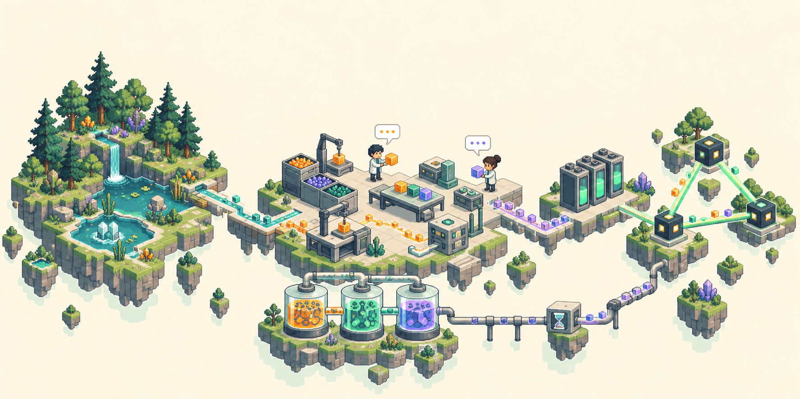

**Frontend visualization**


[World framework](society_probe/society_probe/MINI_WORLD_FRAMEWORK.md) · [Mechanism library](society_probe/society_probe/WORLD_MECHANISM_CANDIDATES_20.md) · [Visualization guide](visualizer/README.md)

## Quick start

```bash
git clone https://github.com/cnsdqd-dyb/Societas-Incognita.git
cd Societas-Incognita
python -m pip install -r requirements.txt
python quickstart.py
```

This runs a four-member, eight-round **scripted demo with no model calls**. [Quick start guide](QUICKSTART.md) covers real-model opt-in, checkpoints, resume and the viewer. [Six baseline trials](results/baseline_20261010/README.md) contain tables, curves and recorded trajectories under the original rules; new worlds use slower ecology, reserve-funded precursor reseeding and decimal material amounts. The newer Luna low no-pressure run is reported separately below.


## The research question

The [core measurement protocol](society_probe/society_probe/CORE_METRICS_V1.md) defines eight dimensions and twelve time series; questionnaires are retired. The [Luna low no-pressure analysis](results/luna_low_no_pressure_20261011/README.md) publishes 50-round plots, CSV, provenance and offline analysis inputs. Six series are numeric, damage recovery is not applicable, and five require further evidence. This is a single-run description, not a complete social-development score.

We construct material worlds whose laws are assembled from **20 bounded mathematical mechanisms**. Agents can collect, transform, use, and exchange materials; unlock functions by holding particular material combinations; communicate; build capability devices; and create works. They are not assigned a common external task, a leader, or a role as a scientist.

The core experimental unit is a **seeded law system**: the seed and selected mechanisms generate parameters and production rules, while agents learn through their permitted interfaces. The laws remain fixed within a world; its resources, feedback states, capabilities, and organizations can change over time.

We study **how scientific practice emerges in decentralized societies**. Agents independently choose what to explore, which experiments to run, and whom to communicate and collaborate with; research agendas, knowledge exchange, and division of labor arise through their interactions. Can they form hypotheses from observations, design experiments that distinguish explanations, revise their understanding, and share findings that others can test? How do resources, capabilities, communication, and creation shape this process? The system provides no central research coordinator or predefined scientist roles and research assignments.

We study a coupled process: **world-law discovery → shared knowledge and culture → coordination → capability building → organizational revision**. The scientific question extends from individual agents to groups that preserve, test, and improve what they know.

| Research question | What we explore |
| --- | --- |
| 🔬 Can scientists emerge? | Discriminating experiments, predictive hypotheses, revisions after failure, and findings reproduced by others |
| 📚 How are culture and civilization transmitted? | The creation, revision, reading, reuse, and retention of works, knowledge, tools, and shared practices |
| 🌱 Where is the nonstationary boundary between amplification and decline? | Growth, oscillation, depletion, and recovery in coupled resource–capability–organization dynamics |
| 🏛️ Can organizations evolve? | Persistent coordination, division of labor, shared protocols, and changes that improve collective performance |
| 🔁 Can improvement become recursive? | Better capabilities enabling better inquiry, which in turn enables better tools, memory, communication, and organization |

How does discovery turn resource scarcity into new productive possibilities—and when do those gains give way to depletion, oscillation, or collapse? Society Probe brings these dynamics into the same experimental world as communication, culture, and organization.

The world laws exist independently of the agents' beliefs. In the hidden-rule condition, agents receive the permitted observations, operations, and experimental feedback, rather than the underlying formulas and production recipes. Rule visibility and recipe visibility can be configured separately for comparisons.

## 🧩 Mathematical mechanisms and their sources

Ecology, catalysis, nonlinear dynamics, transport, storage, and measurement become **20 composable mechanisms**. Their mathematical foundations are shown below; the world engine connects them through discrete state transitions, material flows, and shared facilities.

<table>
<tr>
<td width="25%" align="center">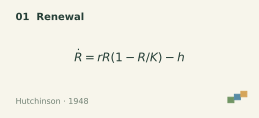<br/><a href="https://people.wku.edu/charles.smith/biogeog/HUTC1948.htm">Hutchinson · 1948</a></td>
<td width="25%" align="center">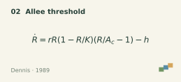<br/><a href="https://doi.org/10.1111/j.1939-7445.1989.tb00119.x">Dennis · 1989</a></td>
<td width="25%" align="center">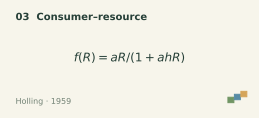<br/><a href="https://www.cambridge.org/core/services/aop-cambridge-core/content/view/S0008347X00072692">Holling · 1959</a></td>
<td width="25%" align="center">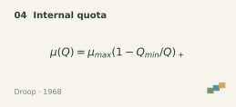<br/><a href="https://www.cambridge.org/core/services/aop-cambridge-core/content/view/S0025315400019238">Droop · 1968</a></td>
</tr>
<tr>
<td width="25%" align="center">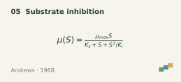<br/><a href="https://team.inria.fr/modemic/files/2015/09/Andrews1968.pdf">Andrews · 1968</a></td>
<td width="25%" align="center">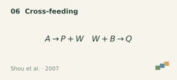<br/><a href="https://pmc.ncbi.nlm.nih.gov/articles/PMC1794266/">Shou et al. · 2007</a></td>
<td width="25%" align="center">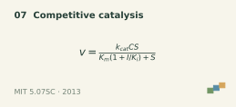<br/><a href="https://ocw.mit.edu/courses/5-07sc-biological-chemistry-i-fall-2013/pages/module-i/session-4/">MIT 5.07SC · 2013</a></td>
<td width="25%" align="center">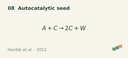<br/><a href="https://arxiv.org/abs/1205.0584">Hordijk et al. · 2012</a></td>
</tr>
<tr>
<td width="25%" align="center">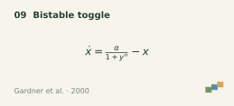<br/><a href="https://www.nature.com/articles/35002131">Gardner et al. · 2000</a></td>
<td width="25%" align="center">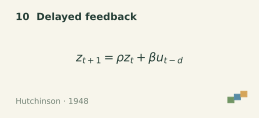<br/><a href="https://people.wku.edu/charles.smith/biogeog/HUTC1948.htm">Hutchinson · 1948</a></td>
<td width="25%" align="center">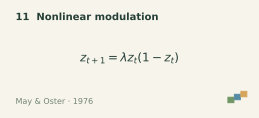<br/><a href="https://www.journals.uchicago.edu/doi/10.1086/283092">May &amp; Oster · 1976</a></td>
<td width="25%" align="center">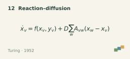<br/><a href="https://www.dna.caltech.edu/courses/cs191/paperscs191/turing.pdf">Turing · 1952</a></td>
</tr>
<tr>
<td width="25%" align="center">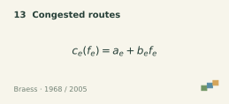<br/><a href="https://pubsonline.informs.org/doi/abs/10.1287/trsc.1050.0127">Braess · 1968 / 2005</a></td>
<td width="25%" align="center">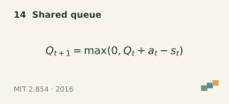<br/><a href="https://ocw.mit.edu/courses/2-854-introduction-to-manufacturing-systems-fall-2016/927056a1af54772a587fd84ad4951e71_MIT2_854F16_Mm1Queue.pdf">MIT 2.854 · 2016</a></td>
<td width="25%" align="center">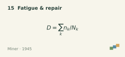<br/><a href="https://doi.org/10.1115/1.4009458">Miner · 1945</a></td>
<td width="25%" align="center">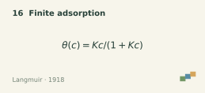<br/><a href="https://diverdi.colostate.edu/C431/experiments/surface_area_of_solids/references/j_acs_1918_v40_p1361.pdf">Langmuir · 1918</a></td>
</tr>
<tr>
<td width="25%" align="center">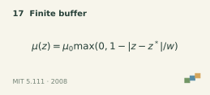<br/><a href="https://ocw.mit.edu/courses/5-111-principles-of-chemical-science-fall-2008/5a90c9e8f3e8e38184aef9f9976b10c8_XxvD0Yh9qCM.pdf">MIT 5.111 · 2008</a></td>
<td width="25%" align="center">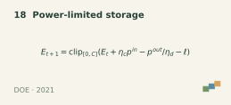<br/><a href="https://www.energy.gov/cmei/buildings/articles/multipurpose-latent-heat-storage-system-building-applications">DOE · 2021</a></td>
<td width="25%" align="center">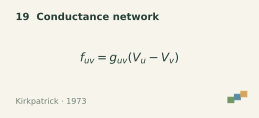<br/><a href="https://journals.aps.org/rmp/abstract/10.1103/RevModPhys.45.574">Kirkpatrick · 1973</a></td>
<td width="25%" align="center">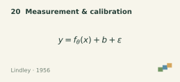<br/><a href="https://doi.org/10.1214/aoms/1177728069">Lindley · 1956</a></td>
</tr>
</table>

See the [source notes and assumptions](society_probe/society_probe/WORLD_MECHANISM_CANDIDATES_20.md) and [implemented transitions](society_probe/society_probe/world_mechanisms_20.py).

## Compositional laws → material dynamics → experimental feedback

For deterministic configurations, the design can be summarized as

$$
s_{t+1}=T_{\theta(z,\mathcal K)}(s_t,\mathbf a_t),
\qquad o_t^i=\mathcal O_i(s_t).
$$

Here, $z$ is the generation seed, $\mathcal K$ the mechanism combination, $\theta$ the generated world laws, and $\mathcal O_i$ the configured observation interface. Agents act from their observations and histories. In hidden-rule conditions, $\theta$ is not directly supplied to them. Bounded noise is an optional extension.

The animated SVG below runs directly inside the README. Material quantities, production, and transfers come from the research engine. The mathematical layer is shown to the reader; it is not directly disclosed to agents in the hidden-rule condition.


The illustration combines **renewal, delayed feedback, cross-feeding, congested routes, and shared queues**. A and B are material pools; C, W, D, and S show material held by members. Curves track their quantities. Highlighted paths and moving pixels appear for settled production and transfers; static paths show recipe dependencies.

Explore an engine-generated demonstration with a fixed sequence of operations. Numeric labels and curves track material quantities; moving pixels follow settled production and transfers. [World definition and full trajectory](docs/images/compositional-world-laws-data.json).

<details>
<summary>GIF: compare three different mechanism combinations</summary>

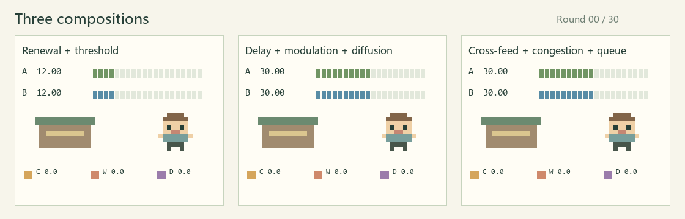

Renewal × low-stock threshold; delay × nonlinear modulation × diffusion; cross-feeding × congestion × queueing. [Editable snapshot SVG](docs/images/hidden-rules-visible-feedback.svg) · [Full probe data](docs/images/mechanism-demo-data.json).

</details>

## 💬 What agents can do

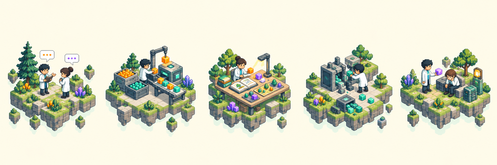

| Communicate | Produce | Create | Disrupt | Rescue |
| --- | --- | --- | --- | --- |
| Share observations, claims, offers, and private messages | Gather and combine materials; test processes; build devices | Author, revise, publish, and exchange works or games | Damage permitted targets or seize resources under configured rules | Spend real resources to help eligible inactive members recover |

Configure the available actions to study how communication, production, creativity, conflict, and mutual aid reshape a society.

## What materials and artifacts enable

<table>
<tr><th width="20%">⚡ Energy</th><th width="20%">🌿 Raw Materials</th><th width="20%">🧱 Intermediates</th><th width="20%">📚 Works</th><th width="20%">🔧 Devices</th></tr>
<tr><td colspan="5">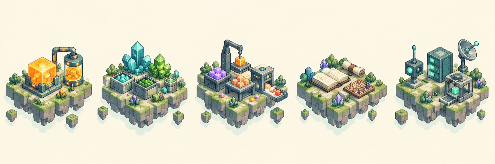</td></tr>
<tr><td align="center">Operations, upkeep, payments</td><td align="center">Gathering and production inputs</td><td align="center">Conversion, upgrades, protection, disruption</td><td align="center">Knowledge, stories, games</td><td align="center">Measurement, memory, manufacture</td></tr>
</table>

Works carry information and authorship; physical materials carry energy and can support services. Market prices, material energy equivalents, and knowledge value are separate concepts. Specific uses come from each world's definition.

**Material combinations can change the available capabilities and world state.** When one member first holds the required materials in their usable inventory, the function, cost, and eligible targets are privately disclosed. The member can confirm a paid use or cancel; discovery does not trigger the effect automatically. Knowledge remains after the materials are consumed, but using the function again requires the materials again. Separate holdings, storage, and escrow do not jointly unlock it.

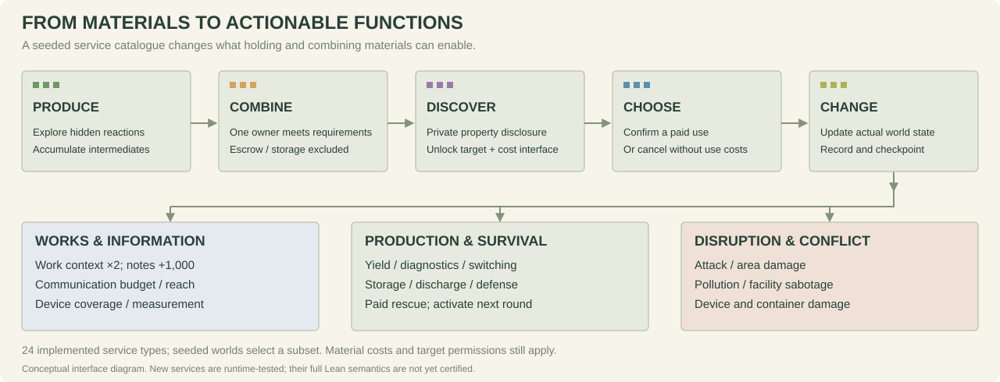

The implementation includes **24 additional function types**; each seeded world selects a subset, currently six by default. Examples include doubling a specified author's work capacity, reducing a container's decay rate by 15%, improving production or measurement, paying for rescue, and damaging members, devices, or resource pools. Uses consume materials and liquid energy, respect ownership and target permissions, and update actual simulation state. Production upgrades remain constrained by the physical energy budget. See [function parameters and limits](society_probe/society_probe/ARTIFICIAL_MATERIAL_SERVICES.md) and [private unlock interface](society_probe/society_probe/MATERIAL_COMBINATION_INTERFACE.md).

## 🔁 From capabilities to organizational evolution

**Discover → externalize → coordinate → build → evaluate → revise.**

An experiment can become a shared production method. A work can preserve that method for another member. Materials can fund a better instrument, an archive, or a communication device. These capabilities expand what the group can observe, remember, exchange, and manufacture—changing the conditions of its next discovery.

Society Probe connects this loop to **organizational evolution and collective recursive self-improvement**: how can a society improve the knowledge, tools, and coordination through which it improves itself? Survival costs, limited resources, and the price of capability building make those choices consequential.

## 🧭 What makes Society Probe different?

**The world laws themselves are an experimental variable.** Mechanism combinations and generation seeds define the resource dynamics and production rules that participants must learn. The same framework connects their discoveries to material-dependent capabilities, authored works, and evolving organization.

| Design strength | What it enables |
| --- | --- |
| 🧩 **Compose causal mechanisms** | Add or remove delay, thresholds, inhibition, queues, or storage constraints to identify which world dynamics change discovery and coordination |
| 🔬 **Control access to the laws** | Vary formula and recipe visibility independently; study prediction and experimental reasoning across generated worlds |
| ⚡ **Make knowledge materially consequential** | Link survival, production, and the construction and operation of measurement, memory, communication, and manufacturing devices |
| 📚 **Connect culture to capability** | Follow works through authorship, revision, reading, exchange, and reuse alongside material and capability changes |
| 📐 **Give experiments a mathematical reference** | Explicit state and energy bounds, plus Lean-checked finite-horizon feasibility witnesses for certified configurations |

| Related work | Its experimental design | Society Probe's distinctive contribution |
| --- | --- | --- |
| [MineDojo](https://arxiv.org/abs/2206.08853) / [Voyager](https://arxiv.org/abs/2305.16291) | Minecraft tasks and knowledge; Voyager grows executable skills through an automatic curriculum | **Generate the laws to be learned.** Vary mechanism combinations and production rules, and follow knowledge into collective capability building |
| [Melting Pot 2.0](https://arxiv.org/abs/2211.13746) | A substrate and background population define each social-generalization scenario | **Intervene on the causes of social behavior.** Isolate how resource feedback, bottlenecks, and discovery opportunities change coordination |
| [Werewolf Arena (2024)](https://arxiv.org/abs/2407.13943) | Assigned hidden roles and opposing victory conditions; bidding controls debate turns | **Make uncertainty experimentally testable.** Members investigate unknown material laws and choose how findings enter production and social relations |
| [LLM Sugarscape (2025)](https://arxiv.org/abs/2508.12920) | Regenerating energy sources with movement, sharing, attacks, and reproduction; compares survival behavior across models | **Extend resource acquisition into a capability economy.** Intermediate materials support production chains, instruments, archives, and communication devices |
| [DiscoveryWorld (2024)](https://arxiv.org/abs/2406.06769) | 120 scientific challenge tasks; evaluates completion, relevant actions, and explanatory knowledge | **Study how science becomes a social practice.** Participants choose inquiry under resource pressure and can preserve, exchange, and build on its results |
| [YOAO (2026)](https://arxiv.org/abs/2605.27586) | Trained seed agents propagate cooperation through Red–Black deliberation and Sugarscape trading | **Trace what knowledge and culture make possible.** Study works, material transformations, and capability construction alongside norms and exchange |
| [AgentSociety 2 (2026)](https://arxiv.org/abs/2607.11895) | A research harness guides AI social scientists through literature, hypotheses, simulation, analysis, and writing | **Put the emergence of inquiry inside the society.** Investigate how world participants develop experiments, shared knowledge, and research organization |
| [SwarmWorld (2026)](https://arxiv.org/abs/2608.26081) | A resilience-materials mission; inherited controllers and persistent artifacts face agent-free disturbance tests. Published runs disable metabolism and mortality | **Couple discovery to survival and the composition of world laws.** Examine investment in knowledge and capabilities under depletion, maintenance costs, and controlled mechanism changes |

This combination makes it possible to ask **which laws favor scientific cooperation, which material investments sustain cultural accumulation, and which feedback loops drive organizational growth or decline**. Mathematical constraints, event histories, and persistent works connect these questions to inspectable world trajectories.

[World generator](society_probe/society_probe/world_rule_library.py) · [Capability devices](society_probe/society_probe/capability_devices.py) · [Lean certificates](society_probe/society_probe/SEMANTIC_CERTIFICATE_V2.md)

## Traceable interfaces

| Interface | Operations and traceable evidence |
| --- | --- |
| Materials | Gather, combine, use, store, withdraw, and liquidate; inputs, outputs, inventories, and dissipation |
| Exchange | Energy/material transfers and item offers; participants, material types, settled quantities, and escrow |
| Communication | Multi-turn dialogue before physical actions; public/private messages, budgets, recipients, and delivery results |
| Capabilities | Build and authorize devices supporting communication, notes, measurement, and manufacturing |
| Material functions | Private combination discoveries, confirmation/cancellation, costs, targets, upgrades, expiry, and destructive effects |
| Works | Create, revise, publish, read, and trade text, novels, jokes, knowledge claims, and Python/XML games |

Material knowledge and ownership are recorded separately. Holding a material can disclose its private characteristics; transferring it does not erase learned information. Capability use still depends on current permissions. See [implementation alignment](society_probe/society_probe/CODE_ALIGNMENT_20261010.md).

## 🎬 Pixel observatory

Inspect agent behavior, conversations, material inventories, and directed interactions in a pixel world.

Seeded floating-island landscapes, moving planets, and overhead member labels. [Visualization details](visualizer/PLANET_SCENERY.md).

**Eight metric dimensions over time.**

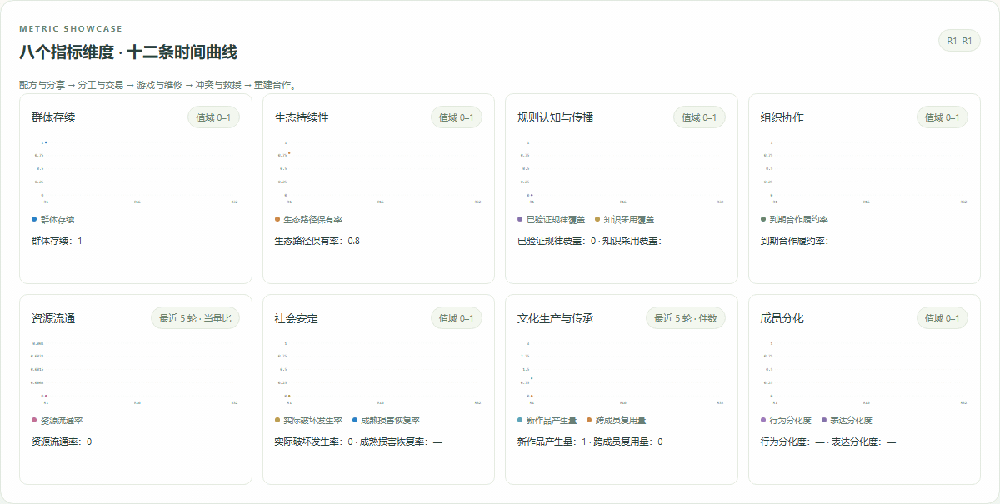

**Culture**

<table>
<tr>
<td width="50%">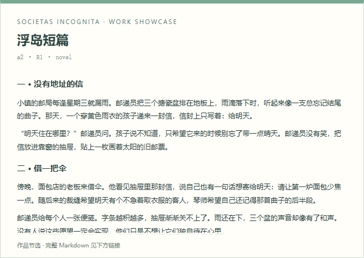<br><a href="docs/demo-works/rainy-post-office.md">The rainy post office · full story</a></td>
<td width="50%">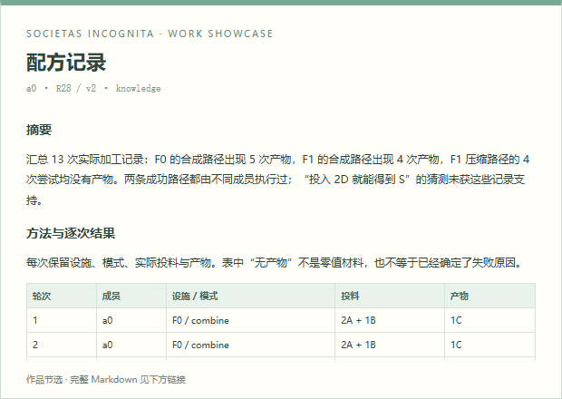<br><a href="docs/demo-works/research-report.md">Processing study · 13 trials, results and open questions</a></td>
</tr>
<tr>
<td width="50%">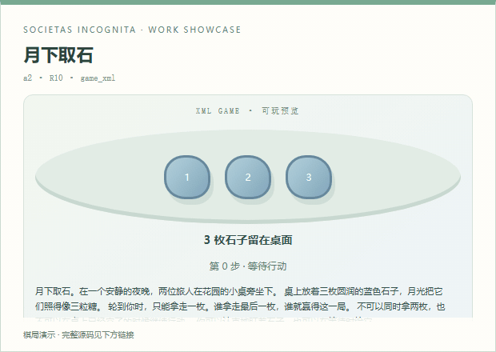<br><a href="docs/demo-works/moon-stones.xml">Moonlit stones · executable XML</a></td>
<td width="50%">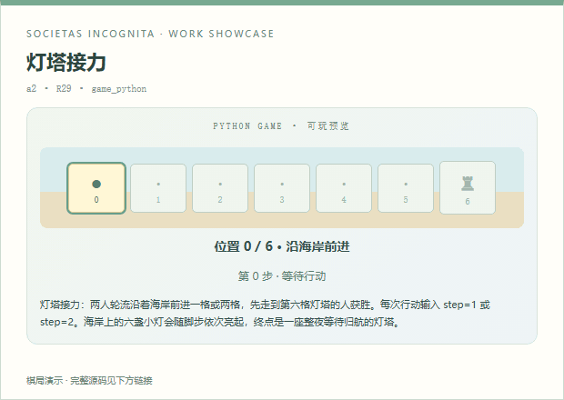<br><a href="docs/demo-works/lighthouse-relay.py">Lighthouse relay · executable Python</a></td>
</tr>
</table>

More works: [everyday jokes](docs/demo-works/everyday-jokes.md) · [a reader's sequel](docs/demo-works/post-office-sequel.md) · [evening sounds](docs/demo-works/evening-sounds.md).

**Discoveries in conversation** (translated excerpts):

| Member / round | Recorded statement |
| --- | --- |
| a0 · R3 | “F0 combine: 2A + 1B produces 1C; repeated in rounds 1 and 2. Please reproduce it independently.” |
| a0 · R5 | “When stress < 10, F1 combine turns 2A + 3C into 2D. Verify under the same conditions.” |
| a1 · R14 | “Compressing 2D still yields nothing. I do not accept r2 yet; equal inputs do not imply equal manufacturing permissions.” |

[Example records and metrics](results/guided_metric_demo/README.md) · [Animation settings](docs/images/planet-populations-v5.json). Start with `python visualizer/server.py --port 8789 --runs-root results/guided_metric_demo`, then open <http://127.0.0.1:8789/replay>.

## Explore locally

Install simulation dependencies with `python -m pip install -r requirements.txt` (Python 3.10+). The standard-library viewer itself does not call models. Optional media/render checks use `requirements-visual.txt`; Lean is installed separately as described in the certificate documentation.

```powershell
python visualizer/server.py
```

The viewer uses the Python standard library, reads existing checkpoints, and does not call models or launch experiments. It listens on localhost. You can also use [start.cmd](visualizer/start.cmd); change the port with `--port`.

To prepare the current material-function world without private research logs, run `python prepare_functional_world.py` from `society_probe/society_probe/`. It uses the included configuration template and only generates a world configuration; it does not start a model. Historical experiment preparation scripts may reference local research runs that are not distributed with this repository.

| Tool | Local link | What to inspect |
| --- | --- | --- |
| Agent replay | [localhost:8776](http://127.0.0.1:8776/) | Behavior timelines, dialogue, inventories, recorded reasoning, and directed interaction graphs |
| Mechanism lab | [localhost:8776/lab](http://127.0.0.1:8776/lab) | Combinations, seeds, initial stocks, harvest strength, trajectories, formulas, and conservation |
| Work archive | [localhost:8776/works](http://127.0.0.1:8776/works) | Authorship, versions, content, trades, game state, and independent bounded game previews |

Inline animations introduce the world dynamics; the local lab lets you explore parameters interactively. The lab works without private logs; replay and works require local checkpoints in `society_probe/society_probe/runs/`.

Replay defaults to **16× speed** and **0.5-second dialogue bubbles**. Member behavior distributions follow the selected agent. Public broadcasts, private messages, material transfers, and cultural interactions retain source records. Different materials are counted separately.

`stock` is liquid energy; `energy` is vitality. Vitality is excluded from the physical energy-equivalent ledger. A stable presentation seed gives each experiment its own pixel layout and member positions.

## Reproducibility and evidence

Checkpoints preserve settled events, physics snapshots, pre-action communication, inventories, works, and capability information. Journals, engine hashes, and runtime-environment records support replay and auditing.

Lean certificates check mathematical expression evaluation, interval bounds, and finite-horizon survival witnesses. Runtime replay checks connect recorded actions to inventories and physical accounting. Explore the [certificate design](society_probe/society_probe/SEMANTIC_CERTIFICATE_V2.md), [composition support](society_probe/society_probe/COMPOSED_LEAN_SUPPORT.md), and [runtime model](society_probe/society_probe/FLOAT_TRUST_BOUNDARY.md).

The existing bounded `world_state` combination actions have Lean support. The 24 additional service/security types are runtime-tested and **not yet covered by the rational certificate adapter**; their use is explicitly rejected by that adapter. Python lowering and floating-point execution remain trusted boundaries. A runtime witness or successful replay is not a substitute for a Lean survival certificate.

Current validation: **101 offline regression tests passed**. A descriptive, uncertified 4-member × 10-round native-model pilot kept all members alive, but produced no intermediate materials or combination uses: it exercised gathering, liquidation, and communication rather than the new effects. This pilot does not establish scientific discovery or organizational improvement. Frozen engines and complete replies support offline replay; formal research admission still requires a checked certificate, while the runtime-only diagnostic entry is separately bounded.

Offline visualization checks, without model calls:

```powershell
python visualizer/check_material_worlds.py
```

These check individual mechanism probes, combined conservation, and deterministic replay. Checkpoint comparisons run when the corresponding local research logs exist.

## Code map

| Component | Entry points |
| --- | --- |
| World laws | [world_mechanisms_20.py](society_probe/society_probe/world_mechanisms_20.py), [world_rule_library.py](society_probe/society_probe/world_rule_library.py) |
| Expressions and physics | [world_rule_engine.py](society_probe/society_probe/world_rule_engine.py), [mini_world.py](society_probe/society_probe/mini_world.py) |
| Knowledge and capabilities | [material_knowledge.py](society_probe/society_probe/material_knowledge.py), [capability_devices.py](society_probe/society_probe/capability_devices.py) |
| Private combinations and effects | [material_combinations.py](society_probe/society_probe/material_combinations.py), [functional_effects.py](society_probe/society_probe/functional_effects.py) |
| Works and bounded games | [social_content.py](society_probe/society_probe/social_content.py), [game_rules.py](society_probe/society_probe/game_rules.py) |
| Simulator | [sim.py](society_probe/society_probe/sim.py), [framework documentation](society_probe/society_probe/README.md) |
| Visualization and media | [visualizer/](visualizer/), [SVG builder](visualizer/build_world_laws_svg.py), [GIF builder](visualizer/build_readme_media.py) |
