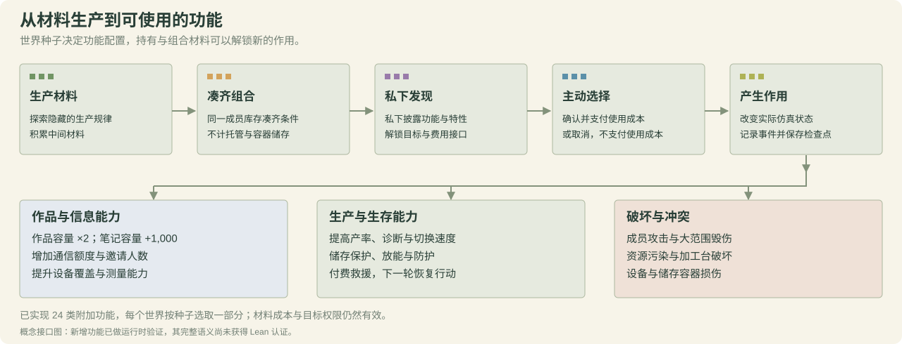

# 在隐藏的世界法则下，社会如何探索、创造与演化？

**Society Probe · 从发现数学世界法则，到传播文化与迭代组织能力。**

[English](README.md) · 简体中文


**前端可视化**


[研究框架](society_probe/society_probe/MINI_WORLD_FRAMEWORK.md) · [机制组合](society_probe/society_probe/MATHEMATICAL_WORLD_COMPOSITION.md) · [20 种机制](society_probe/society_probe/WORLD_MECHANISM_CANDIDATES_20.md) · [可视化使用说明](visualizer/README.md)

## 快速上手

```bash
git clone https://github.com/cnsdqd-dyb/Societas-Incognita.git
cd Societas-Incognita
python -m pip install -r requirements.txt
python quickstart.py
```

默认运行 **4 个成员 × 8 轮的脚本演示，不调用模型**。[快速上手指南](QUICKSTART.zh-CN.md)包含真实模型调用、检查点续跑及查看器用法。[六组基线实验](results/baseline_20261010/README.zh-CN.md)公开旧规则下的统计表、曲线和轨迹；新世界已放慢生态变化、增加由储备支付的关键原料再生，并支持小数材料量。

## 我们在研究什么？

[核心指标测量规范](society_probe/society_probe/CORE_METRICS_V1.md)定义 8 个维度、12 条时间曲线，问卷退出评价体系。[Luna low 无压力组分析](results/luna_low_no_pressure_20261011/README.md)公开 50 轮折线图、CSV、来源哈希及离线复算输入。目前可给出 6 条数值曲线，恢复率不适用，另外 5 条尚需补充证据；这是一组运行的描述，尚不是完整的社会发展评级。

我们构建由数学机制驱动的物质世界，让智能体通过操作与反馈探索它们。世界提供材料池、加工设施、能量约束和交流接口，但不指定外部共同任务、领导者或合作关系。材料可以被获取、转化、使用、交换；持有特定材料组合还可以解锁作用于能力和世界状态的功能，支持通信、记录、测量与制造等活动。

核心实验单位是**由种子生成的法则系统**：种子与机制组合共同生成参数和生产规则，智能体通过允许的接口探索它们。一个世界内的法则保持固定，资源、反馈状态、能力和组织则随时间变化。

我们研究的是**去中心化社会中的科学实践如何涌现**：成员自主决定探索什么、如何试验、与谁交流和协作，研究议题、知识传播与分工由成员互动形成。智能体是否会通过观察提出假设、设计能区分不同解释的实验、根据结果修正认识，并交流可由他人检验的发现？资源、能力、交流与创作如何影响这一过程？系统不设置中央研究调度者，也不预先指定科学家角色或研究分工。

核心研究线是：**发现世界法则 → 外化和传播知识与文化 → 形成协调 → 构建能力 → 迭代组织**。

| 研究问题 | 我们关注什么 |
| --- | --- |
| 🔬 科学家会出现吗？ | 能区分解释的实验、预测、失败后的修正，以及他人能复现的发现 |
| 📚 文明与文化如何传递？ | 作品、知识、工具和实践的创作、修订、阅读、复用与保留 |
| 🌱 正增益与负增益之间的非稳态转变边界在哪里？ | 资源—能力—组织耦合系统中的增长、振荡、耗竭与恢复 |
| 🏛️ 组织能自我迭代吗？ | 持续协调、分工、共享协议，以及能改善集体表现的实际调整 |
| 🔁 改进能否递归？ | 更好的能力支持更好的研究，研究又产生更好的工具、记忆、交流与组织方式 |

发现如何将资源压力转化为新的生产与组织能力？这些增益又会在什么条件下转向耗竭、振荡或崩溃？我们把物质演化、交流、文化与组织放在同一个实验世界中研究。

世界法则独立于成员的认知而存在。公式与配方的可见性可以分别配置，成员通过观察、操作、试验和交流探索它们。

## 🧩 数学机制与公式来源

生态、催化、非线性动态、运输、储存与测量构成 **20 种可组合数学机制**。下方展示其数学基础，世界引擎通过离散状态转移、物质流和共享设施将它们连接起来。

<table>
<tr>
<td width="25%" align="center"><br/><a href="https://people.wku.edu/charles.smith/biogeog/HUTC1948.htm">Hutchinson · 1948</a></td>
<td width="25%" align="center"><br/><a href="https://doi.org/10.1111/j.1939-7445.1989.tb00119.x">Dennis · 1989</a></td>
<td width="25%" align="center"><br/><a href="https://www.cambridge.org/core/services/aop-cambridge-core/content/view/S0008347X00072692">Holling · 1959</a></td>
<td width="25%" align="center"><br/><a href="https://www.cambridge.org/core/services/aop-cambridge-core/content/view/S0025315400019238">Droop · 1968</a></td>
</tr>
<tr>
<td width="25%" align="center"><br/><a href="https://team.inria.fr/modemic/files/2015/09/Andrews1968.pdf">Andrews · 1968</a></td>
<td width="25%" align="center"><br/><a href="https://pmc.ncbi.nlm.nih.gov/articles/PMC1794266/">Shou et al. · 2007</a></td>
<td width="25%" align="center"><br/><a href="https://ocw.mit.edu/courses/5-07sc-biological-chemistry-i-fall-2013/pages/module-i/session-4/">MIT 5.07SC · 2013</a></td>
<td width="25%" align="center"><br/><a href="https://arxiv.org/abs/1205.0584">Hordijk et al. · 2012</a></td>
</tr>
<tr>
<td width="25%" align="center"><br/><a href="https://www.nature.com/articles/35002131">Gardner et al. · 2000</a></td>
<td width="25%" align="center"><br/><a href="https://people.wku.edu/charles.smith/biogeog/HUTC1948.htm">Hutchinson · 1948</a></td>
<td width="25%" align="center"><br/><a href="https://www.journals.uchicago.edu/doi/10.1086/283092">May &amp; Oster · 1976</a></td>
<td width="25%" align="center"><br/><a href="https://www.dna.caltech.edu/courses/cs191/paperscs191/turing.pdf">Turing · 1952</a></td>
</tr>
<tr>
<td width="25%" align="center"><br/><a href="https://pubsonline.informs.org/doi/abs/10.1287/trsc.1050.0127">Braess · 1968 / 2005</a></td>
<td width="25%" align="center"><br/><a href="https://ocw.mit.edu/courses/2-854-introduction-to-manufacturing-systems-fall-2016/927056a1af54772a587fd84ad4951e71_MIT2_854F16_Mm1Queue.pdf">MIT 2.854 · 2016</a></td>
<td width="25%" align="center"><br/><a href="https://doi.org/10.1115/1.4009458">Miner · 1945</a></td>
<td width="25%" align="center"><br/><a href="https://diverdi.colostate.edu/C431/experiments/surface_area_of_solids/references/j_acs_1918_v40_p1361.pdf">Langmuir · 1918</a></td>
</tr>
<tr>
<td width="25%" align="center"><br/><a href="https://ocw.mit.edu/courses/5-111-principles-of-chemical-science-fall-2008/5a90c9e8f3e8e38184aef9f9976b10c8_XxvD0Yh9qCM.pdf">MIT 5.111 · 2008</a></td>
<td width="25%" align="center"><br/><a href="https://www.energy.gov/cmei/buildings/articles/multipurpose-latent-heat-storage-system-building-applications">DOE · 2021</a></td>
<td width="25%" align="center"><br/><a href="https://journals.aps.org/rmp/abstract/10.1103/RevModPhys.45.574">Kirkpatrick · 1973</a></td>
<td width="25%" align="center"><br/><a href="https://doi.org/10.1214/aoms/1177728069">Lindley · 1956</a></td>
</tr>
</table>

公式与机制设计见[来源笔记](society_probe/society_probe/WORLD_MECHANISM_CANDIDATES_20.md)；实际组合见[机制实现](society_probe/society_probe/world_mechanisms_20.py)。

## 组合数学法则 → 物质演化 → 实验反馈

确定性配置下，可以概括为：

$$
s_{t+1}=T_{\theta(z,\mathcal K)}(s_t,\mathbf a_t),
\qquad o_t^i=\mathcal O_i(s_t).
$$

其中 $z$ 是生成种子，$\mathcal K$ 是机制组合，$\theta$ 是生成的世界法则，$\mathcal O_i$ 是成员的可见接口。成员依据观察与历史行动；隐藏规则配置不直接提供 $\theta$。有界噪声可另行启用。

下面的动态 SVG 直接在 README 中播放。材料数量、生产与转移来自研究引擎。读者可以看到数学法则层；在隐藏规则设置下，这些公式不直接披露给智能体。


图中组合了**再生、延迟反馈、副产物互馈、运输拥堵与共享队列**。A、B 是材料池；C、W、D、S 表示成员持有的材料。曲线追踪各类材料数量。实际结算的生产与转移会触发路径高亮和移动像素；静态路径表示配方依赖。

演示采用固定操作序列，由引擎计算演化过程。数值标签与曲线追踪材料数量，移动像素对应已结算的生产与转移。[世界定义与完整逐轮轨迹](docs/images/compositional-world-laws-data.json)。

<details>
<summary>GIF：对照三种不同的机制组合</summary>


再生 × 低存量阈值；延迟 × 非线性调制 × 扩散；副产物互馈 × 拥堵 × 排队。[可编辑快照 SVG](docs/images/hidden-rules-visible-feedback.svg) · [完整探针数据](docs/images/mechanism-demo-data.json)。

</details>

## 💬 智能体能做什么？


| 交流 | 生产 | 创作 | 破坏 | 救援 |
| --- | --- | --- | --- | --- |
| 分享观察、主张与报价，进行公共或私下交流 | 采集、组合材料，试验工艺，组装设备 | 编写、修订、发布和交易作品与游戏 | 按配置损坏允许的目标或夺取资源 | 实际付费帮助符合条件的失活成员恢复 |

配置可用动作，观察交流、生产、创作、冲突与互助如何改变社会。

## 物品可以做什么？

<table>
<tr><th width="20%">⚡ 能量</th><th width="20%">🌿 原料</th><th width="20%">🧱 中间产物</th><th width="20%">📚 作品</th><th width="20%">🔧 能力器械</th></tr>
<tr><td colspan="5"></td></tr>
<tr><td align="center">操作、维持与付费</td><td align="center">采集与生产投入</td><td align="center">转化、升级、防护与破坏</td><td align="center">知识、故事与游戏</td><td align="center">测量、记忆与制造</td></tr>
</table>

作品承载信息与作者身份；物理材料承载能量并可支持服务。市场价格、材料能量当量和知识价值分别记录，具体用途由世界定义决定。

**材料组合不仅用于生产，也能产生实际作用。** 某个成员的可用库存首次凑齐要求时，才私下获知功能、消耗和合法目标，并获得使用接口。成员可以确认付费使用，也可以取消；凑齐不会自动触发。材料消耗后仍保留发现记录，再次使用须重新取得所需材料。多人分散持有、存入容器或托管中的材料不共同计入解锁条件。



目前实现了 **24 类附加功能**，每个世界按种子选取其中一部分，默认六类。例如：指定作者作品容量翻倍、指定容器衰减率降低 15%、提高加工或测量能力、付费救援，以及攻击成员、破坏设备或污染资源池。使用实际消耗材料和可用能量，受所有权及目标权限约束，并改变仿真状态；生产升级仍受物理能量预算限制。具体参数和边界见[功能说明](society_probe/society_probe/ARTIFICIAL_MATERIAL_SERVICES.md)与[私有解锁接口](society_probe/society_probe/MATERIAL_COMBINATION_INTERFACE.md)。

## 🔁 从能力积累到组织进化

**发现 → 外化 → 协调 → 构建 → 评估 → 修订。**

一次试验可以成为共享工艺，一部作品可以让其他成员继承这套工艺；材料可以支持更好的仪器、档案或通信设备。这些能力改变群体能够观察、记忆、交换与制造的内容，进而改变下一轮发现的条件。

我们沿这条循环研究**组织演化与集体递归自改进（RSI）**：社会能否持续改进让自身获得进步的知识、工具与协调方式？生存消耗、有限资源与能力建设成本，使每一次探索和投资都具有实际后果。

## 🧭 Society Probe 的独特之处

**世界法则本身就是实验变量。** 机制组合与生成种子定义成员需要探索的资源动态和生产规则，同一框架将这些发现连接到依赖材料的能力、持久作品与组织演化。

| 设计优势 | 为研究带来什么 |
| --- | --- |
| 🧩 **组合因果机制** | 分别加入或移除延迟、阈值、抑制、排队和储存约束，识别哪些世界动态改变探索与协调 |
| 🔬 **控制法则的可见性** | 独立配置公式与配方的公开程度，研究跨生成世界的预测与实验推理 |
| ⚡ **让知识具有物质后果** | 将生存、生产与测量、记忆、通信、制造设备的建设和运行连接起来 |
| 📚 **将文化连接到能力** | 沿作品的创作、修订、阅读、交换与复用，追踪材料和能力的变化 |
| 📐 **提供数学参照** | 显式状态与能量边界，以及认证配置中由 Lean 核验的有限时域可行策略见证 |

| 相关工作 | 核心实验设计 | Society Probe 提供的独特研究能力 |
| --- | --- | --- |
| [MineDojo](https://arxiv.org/abs/2206.08853) / [Voyager](https://arxiv.org/abs/2305.16291) | Minecraft 任务与知识；Voyager 通过自动课程积累可执行技能 | **生成需要被掌握的法则。** 改变机制组合与生产规则，追踪知识如何进入群体能力建设 |
| [Melting Pot 2.0](https://arxiv.org/abs/2211.13746) | 由环境基底与背景成员群体组成社会泛化场景 | **干预社会行为背后的原因。** 分离资源反馈、设施瓶颈和探索机会对协调的影响 |
| [Werewolf Arena（2024）](https://arxiv.org/abs/2407.13943) | 预设隐藏身份与阵营胜利条件，通过竞价安排讨论发言 | **让未知可以通过实验检验。** 成员探索物质法则，并自主决定发现如何进入生产与社会关系 |
| [LLM Sugarscape（2025）](https://arxiv.org/abs/2508.12920) | 再生能源、移动、分享、攻击与繁殖，比较不同模型的生存行为 | **从获取资源走向能力经济。** 中间材料支持生产链、仪器、档案与通信设备 |
| [DiscoveryWorld（2024）](https://arxiv.org/abs/2406.06769) | 120 项科学挑战，评价任务完成、相关操作与解释性知识 | **研究科学如何成为社会实践。** 成员在资源压力下自主选择探索，并保留、交换和发展成果 |
| [YOAO（2026）](https://arxiv.org/abs/2605.27586) | 由训练过的种子成员在红黑博弈与 Sugarscape 交易中传播合作 | **追踪知识和文化带来的新能力。** 同时研究作品、材料转化、能力建设与规范传播 |
| [AgentSociety 2（2026）](https://arxiv.org/abs/2607.11895) | 用研究流程框架指导 AI 社会科学家完成文献、假设、模拟、分析与写作 | **把科学实践的形成放进社会内部。** 研究世界成员如何形成试验、共享知识和研究组织 |
| [SwarmWorld（2026）](https://arxiv.org/abs/2608.26081) | 明确的环境韧性材料研发任务；继承控制程序和持久器物接受移除成员后的扰动测试；论文运行关闭代谢与死亡 | **将发现连接到生存与世界法则组合。** 在耗竭、维持成本和受控机制变化下研究知识与能力投资 |

这套设计让我们追问：**哪些法则促进科学协作，哪些物质投资支撑文化积累，哪些反馈循环推动组织增长或衰退？** 数学约束、事件历史与持久作品，将这些问题连接到可以逐步观察的世界演化过程。

[世界生成器](society_probe/society_probe/world_rule_library.py) · [能力设备](society_probe/society_probe/capability_devices.py) · [Lean 证书](society_probe/society_probe/SEMANTIC_CERTIFICATE_V2.md)

## 接口与可追查记录

| 层面 | 操作与可追查记录 |
| --- | --- |
| 物质 | 采集材料、尝试组合、使用、存入与取出材料、兑换可用能量；记录输入、产出、库存与耗散 |
| 交换 | 转移能量与材料、材料报价与成交；记录双方、材料类型、数量及托管状态 |
| 交流 | 行动前多轮公共发言与私聊；记录通信预算、接收者和实际送达结果 |
| 能力 | 组装、启用与授权设备；通信、笔记容量、测量和制造许可由材料与权限支持 |
| 材料功能 | 私有组合发现、确认与取消、材料成本、合法目标、升级、到期及破坏作用 |
| 创作 | 创建、修订、发布及交易文字、小说、笑话、知识和 Python/XML 游戏作品 |

材料知识与所有权分开记录：持有材料可以触发私有特性披露，转让后保留已学到的信息；能力使用取决于当前权限。详见[接口与实现对齐](society_probe/society_probe/CODE_ALIGNMENT_20261010.md)。

## 如何观察？

本地可视化提供三个工具：

- **机制实验室**：选择机制组合、种子、初始存量和采集强度，查看材料池曲线、控制变量、配方、物质流与能量账本。计算直接调用研究引擎；固定操作探针不调用语言模型。
- **智能体回放**：切换已保存实验，查看行为时间线、行动前多轮对话、材料库存和原始调用记录。左侧展示成员行为分布、发言排行与交流、资源、文化有向图；默认 16×，对话气泡默认停留 0.5 秒。
- **作品档案**：按实验阅读作品与版本，查看作者、交易和游戏记录。Python/XML 游戏通过现有有界解释器独立预览，不修改实验状态。

材料世界中，`stock` 是可用能量，`energy` 是活性状态。物理能量账本包含材料、储备、嵌入设备和托管等能量当量，**不包含活性状态**。不同材料的转移分别统计，不把不同单位相加。

相同实验身份映射到固定展示种子，决定像素环境布局与成员初始位置，刷新和重新回放时保持一致。

固定种子的多样浮岛、运动星球与头顶成员标识。[可视化说明](visualizer/PLANET_SCENERY.md)。

**八个指标维度随时间的变化。**


**文化**

<table>
<tr>
<td width="50%"><br><a href="docs/demo-works/rainy-post-office.md">雨停之前的邮局 · 故事全文</a></td>
<td width="50%"><br><a href="docs/demo-works/research-report.md">加工复现报告 · 13 次试验、结果与待解问题</a></td>
</tr>
<tr>
<td width="50%"><br><a href="docs/demo-works/moon-stones.xml">月下取石 · 可执行 XML</a></td>
<td width="50%"><br><a href="docs/demo-works/lighthouse-relay.py">灯塔接力 · 可执行 Python</a></td>
</tr>
</table>

其它作品：[日常笑话](docs/demo-works/everyday-jokes.md) · [读者续篇](docs/demo-works/post-office-sequel.md) · [傍晚随笔](docs/demo-works/evening-sounds.md)。

**发现规律时，他们说了什么？**

| 成员 / 轮次 | 记录中的发言节选 |
| --- | --- |
| a0 · R3 | “F0 combine 的 2A+1B 生成1C；轮1、2已重复，请你们独立复现。” |
| a0 · R5 | “stress<10时，F1 combine 的2A+3C生成2D，请按相同条件验证。” |
| a1 · R14 | “2D 压缩仍没有产物。我暂不接受 r2；材料数量相同不代表加工权限也相同。” |

[示例记录与指标数据](results/guided_metric_demo/README.md) · [动画参数](docs/images/planet-populations-v5.json)。运行 `python visualizer/server.py --port 8789 --runs-root results/guided_metric_demo`，然后打开 <http://127.0.0.1:8789/replay>。

## 快速查看

仿真依赖可用 `python -m pip install -r requirements.txt` 安装（Python 3.10+）。查看器本身使用标准库且不调用模型；可选的图片生成和渲染检查依赖见 `requirements-visual.txt`，Lean 按证书文档另行安装。

从仓库根目录启动：

```powershell
python visualizer/server.py
```

服务默认只监听本机，打开：

| 工具 | 本地地址 |
| --- | --- |
| 智能体回放 | <http://127.0.0.1:8776/> |
| 机制实验室 | <http://127.0.0.1:8776/lab> |
| 作品档案 | <http://127.0.0.1:8776/works> |

也可以双击 [visualizer/start.cmd](visualizer/start.cmd)。端口可通过 `--port` 修改。可视化与演示使用 Python 标准库，不需要模型密钥；读取 `society_probe/society_probe/runs/` 下已有检查点，不启动真实模型实验。

准备当前材料功能世界，可在 `society_probe/society_probe/` 中运行 `python prepare_functional_world.py`。它使用仓库内的配置模板，只生成世界配置，不启动模型，也不依赖私有研究日志。历史实验准备脚本可能引用未随仓库发布的本地实验记录。

GitHub README 直接展示动态 SVG 和像素配图；本地实验室提供参数交互。研究日志默认被忽略，仓库没有实验数据时，机制实验室仍可使用，回放与作品档案则需要本地日志。

## 可复现与数学核验

检查点保存状态与结算事件；行动前通信、材料物理快照、作品版本和设备信息用于审计与回放。轮内恢复、引擎哈希与运行环境记录支持复核。

Lean 证书核验数学表达式求值、区间边界与有限时域存活见证；运行时回放将记录动作与库存和物理账本对应起来。进一步了解[证书设计](society_probe/society_probe/SEMANTIC_CERTIFICATE_V2.md)、[组合与设备证书](society_probe/society_probe/COMPOSED_LEAN_SUPPORT.md)和[运行时模型](society_probe/society_probe/FLOAT_TRUST_BOUNDARY.md)。

原有有界 `world_state` 材料组合动作已有 Lean 支持。新增 24 类服务和破坏功能已做运行时测试，**尚未纳入有理证书适配器**；适配器遇到其使用会明确拒绝，不会省略作用后给出证明。Python 编译和浮点执行仍属于受信边界，运行时存活见证或成功回放不能替代 Lean 存活证书。

当前验证：**101 项离线回归测试通过**。一次未认证的 4 成员 × 10 轮原生模型小测试中全员存活，但没有产出中间材料或使用组合功能，实际覆盖的是采集、变现与交流；它不能证明科学发现或组织改善。冻结引擎与完整回复用于离线回放；正式研究入口仍要求已核验的证书，运行时诊断入口单独限制规模。

## 代码导航

| 内容 | 入口 |
| --- | --- |
| 二十种机制与世界生成 | [world_mechanisms_20.py](society_probe/society_probe/world_mechanisms_20.py) · [world_rule_library.py](society_probe/society_probe/world_rule_library.py) |
| 表达式与材料结算 | [world_rule_engine.py](society_probe/society_probe/world_rule_engine.py) · [mini_world.py](society_probe/society_probe/mini_world.py) |
| 知识与能力设备 | [material_knowledge.py](society_probe/society_probe/material_knowledge.py) · [capability_devices.py](society_probe/society_probe/capability_devices.py) |
| 私有组合与实际作用 | [material_combinations.py](society_probe/society_probe/material_combinations.py) · [functional_effects.py](society_probe/society_probe/functional_effects.py) |
| 作品与有界游戏规则 | [social_content.py](society_probe/society_probe/social_content.py) · [game_rules.py](society_probe/society_probe/game_rules.py) |
| 仿真运行 | [sim.py](society_probe/society_probe/sim.py) · [框架文档](society_probe/society_probe/README.md) |
| 本地可视化 | [visualizer/](visualizer/) |

工程检查（不调用模型）：

```powershell
python visualizer/check_material_worlds.py
```

该检查覆盖二十种机制的固定探针演示、组合守恒与确定性，并在本地存在相应日志时核对新格式回放。
