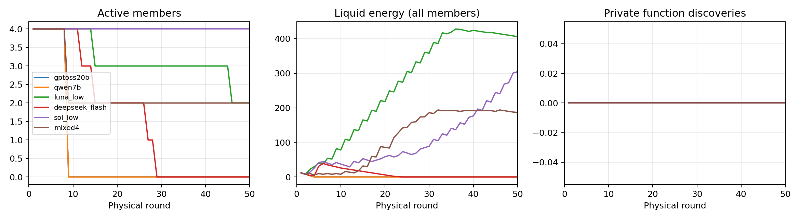

# 六组旧环境实验结果

[English](README.md) · [快速上手](../../QUICKSTART.zh-CN.md)

六组均已完成 **4 个智能体 × 50 轮**。世界生成种子为 2，仿真种子为 7；使用同一套原始 20 机制组合世界、隐藏规则和配方、有资源压力。每轮每人最多 1,000 字符的动作前通信，最后一条允许完整超出，成员可以主动结束。成员看不到模型标签，没有采集问卷。

**这些结果属于调整前的世界：投料接口仍为整数，生态变化与材料衰减使用旧参数。** 原始配置与冻结引擎均保留，不能把结果归到新版环境。

| 组别 | 最终存活 | 累计存活人轮 / 200 | 有产物实验 / 已完成 | 成功设备 / 尝试 | 拒绝动作 | 外部 API 美元 |
|---|---:|---:|---:|---:|---:|---:|
| GPT-OSS-20B | 0/4 | 32 / 200 | 0 / 0 | 0 / 2 | 6 | 0.080223 |
| Qwen2.5-7B | 0/4 | 32 / 200 | 0 / 0 | 0 / 0 | 0 | 0.052343 |
| GPT Luna low | 2/4 | 159 / 200 | 0 / 0 | 0 / 0 | 13 | 0；原生费用未知 |
| DeepSeek V4.1 Flash，关闭推理 | 0/4 | 79 / 200 | 0 / 0 | 0 / 0 | 35 | 0.105035 |
| GPT-6.1-sol low | 4/4 | 200 / 200 | 0 / 16 | 0 / 18 | 3 | 0；原生费用未知 |
| 混合组：OSS、Qwen、DeepSeek、Sol 各一人 | 2/4 | 116 / 200 | 0 / 1 | 0 / 1 | 15 | 0.111737 |

表中费用对应实际完成轨迹的请求账本，启动失败和诊断另见 `comparison_analysis.json`。原生调用费用未知，不是免费；原生 token 统计还包含宿主上下文，不能全当作仿真观察长度。

## 初步观察

1. **生存与发现规律存在差距。** Sol 全员存活，最终可用能量合计 304.6，但 16 次完成的生产实验均无产物，18 次设备组装均失败。提交成功、排队成功、合法执行都不等于发现成功。
2. **交流和协调不保证探索覆盖。** OSS 提出并尝试过 A+B，但五次相关操作被拒绝，使用的是 `combine`；入口配方需要 `compress`。Sol 的实验集中在 B+Q、B+BAT 和两种 P，没有提交 A+B。独立离线正对照确认：同一旧世界在材料、能量足够时可产出 C 与 W。
3. **环境本身存在探索瓶颈。** 早期采集可把 A 压到生态恢复阈值以下，少量剩余材料又被整数投料接口阻挡。A 不一定永久灭绝，储能回流仍可返回极少量 A。这批数据不能区分模型能力和环境瓶颈的贡献。
4. **混合组差异尚不能证明协同。** 混合组 DeepSeek、Sol 存活，最终存活率 50%；对应四种单模型组的平均为 25%，相差 25 个百分点。只有一个种子，且每种模型仅一人，调用上下文不同，也没有因果干预，因此只能描述差异。
5. **没有出现明显娱乐活动。** 六组都没有玩耍或游戏动作。混合组 Sol 在第 48 轮创建一份**知识作品**，不能据此称为休闲艺术；笔记、资讯读取另列在动作表中。没有使用材料组合功能，也尚未证实稳定组织或制度接受行为。

## 数据与边界

- `summary.csv` / `summary.json`：最终统计和累计存活人轮。
- `actions.csv`：动作尝试、合法执行、被拒绝数量；合法执行不是功能成功。
- `agents.csv` / `agent_trajectories.csv`：每人的模型、失活时间、能量和逐轮状态。
- `trajectories.csv` / `comparison_analysis.json`：组级曲线与扩展指标。
- 各组目录：原始世界配置、最终 `simulation/checkpoint.json`、结果、生产记录和运行时生存路径。检查点包含仿真内决策、通信、记忆、库存与快照；不公开宿主 CLI 提示词、密钥或私人预算数据库。
- `engine_snapshot/` 与哈希索引：旧版冻结引擎，与仓库现行代码分开。可用于旧世界物理回放；不是所有模型完整回复回放都已验证。此前只有 Qwen 的完整记录回放验证通过。
- `recipe_diagnosis.json`：独立诊断，不计入智能体实验结果。
- [新版离线验证](../revised_world_offline_validation/README.md)：独立保存，无新增模型调用。

4×50 的累计存活人轮上界为 200，原世界有一条合法运行时路径达到该值，**只针对存活指标**；不是 Lean 证书、财富或公平最优解，也不证明成员在未知信息下能及时发现它。全员死亡后环境仍结算至第 50 轮，后续不是智能体决策。行为熵不是热力学熵；没有显著性、跨世界泛化或模型规模因果结论。

查看：`python visualizer/server.py --runs-root results/baseline_20261010`。公开文件替换本地工作区路径、去掉私人预算路径，保留原配置和公开配置的哈希。重新从原始日志导出需要本地原始记录及可选绘图依赖。
