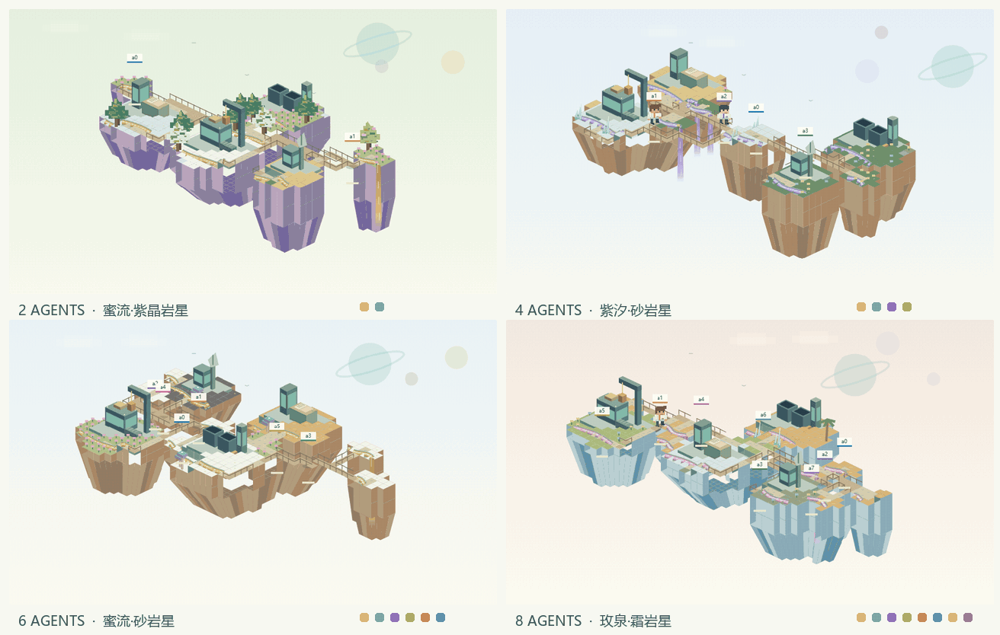
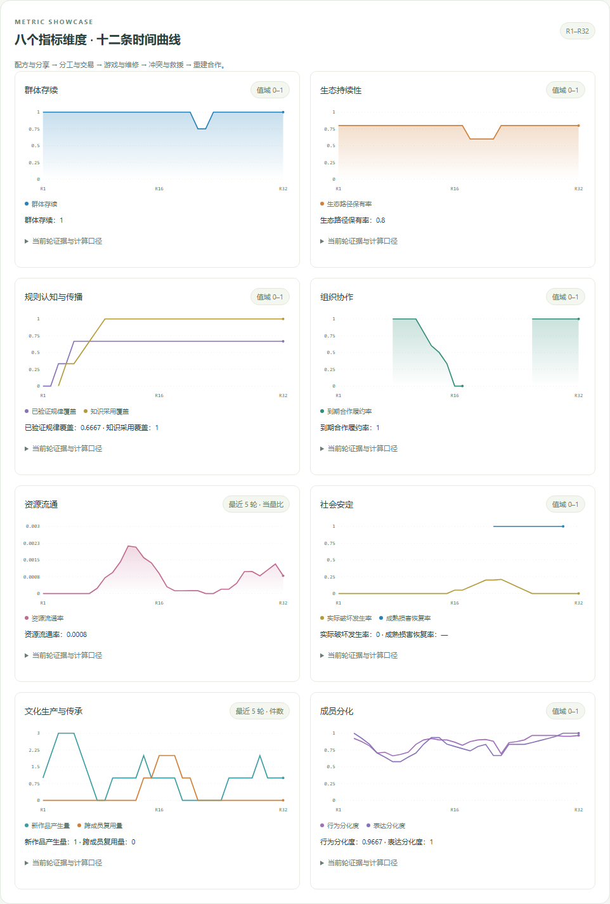
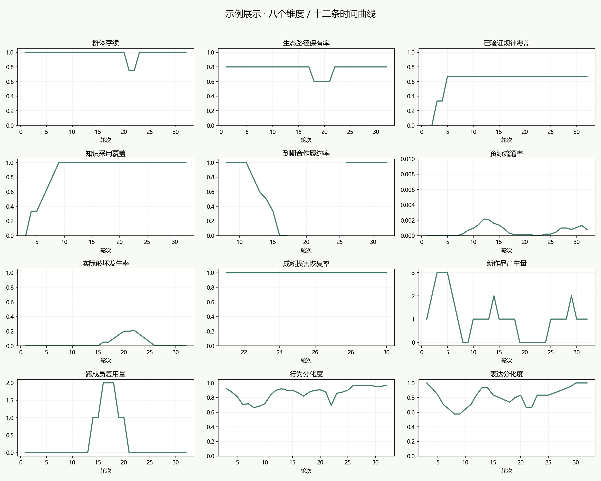

# Example showcase · 示例展示

Four scripted members execute 32 rounds through the environment engine: discovery, cooperation, trade, authored works, games, conflict and rescue. The showcase costs $0 and retains its separate demo metadata.

The fixture supplies initial energy and materials and enables all 24 material functions. Actions settle through the engine, with zero recorded physical accounting residual. Seven substantial works include fiction, jokes, a research report, a sequel, an essay, and executable XML/Python games. The report's second version tabulates thirteen settled processing outcomes: five C outputs, four D outputs and four attempts without a product.



[Read the complete works](../../docs/demo-works/README.md) · [Eight metric cards](../../docs/images/demo-metrics-v5.gif)

| Rounds | Directed content |
| --- | --- |
| 1–7 | Recipe tests, public claims, independent reproductions, novel and joke |
| 8–13 | Accepted division of labor, material transfers, two missed obligations, item and work purchases |
| 14–17 | Three actual turns of a multiplayer game, a non-author rewrite, device damage and repair |
| 18–24 | Pool pollution and purification; attacks, inactivity, paid rescue, and compensation |
| 25–32 | Essay, research-report revision, Python game and renewed cooperation |

There are 127 valid physical actions, 7 new works, 10 due obligations with 8 fulfilled, and 5 damage episodes. Member a2 becomes inactive at the end of round 21, is rescued in round 22, and returns in round 23. The third recipe guess is **refuted** because manufacturing permission is missing: it is not counted as verified knowledge. Two of three recipe claims pass scoped tests; all three other members subsequently reproduce each of those two rules.

## Open the interactive showcase

From the repository root:

```powershell
python visualizer/server.py --port 8789 --runs-root results/guided_metric_demo
```

Open <http://127.0.0.1:8789/replay>. A visible banner identifies the scripted demo. Beneath the activity atlas and ordinary charts, **eight metric cards contain twelve time series**. Hover for values, click a curve to seek a round, and expand the evidence for the current point. Works remain readable in the work archive.





## Evidence and limitations

- [Checkpoint](demo/simulation/checkpoint.json) and [configuration](demo/simulation/config.json) are demo records; every round is saved. The builder supports `--resume`.
- [Metric data](demo/metric_demo.json) include scoped claim tests, message receipts and reproductions, mutually confirmed obligations, actual transfers, damage/recovery coding, reuse links and path probes. [CSV](demo/metrics.csv) contains the twelve series.
- [Ordinary metric adapter output](demo/core_metrics.json) is kept separately and retains its missing-evidence statuses. The additional semantic/physical coding is **specific to this directed demo**, not a newly complete general-purpose research adapter.
- Ecology here checks five fixed one-action routes from member a0's actual state, with explicit output thresholds. This restricted catalog is not a global ecological rating, unrestricted reachability result, or Lean certificate. The missing manufacturing permission explains the baseline 4/5 path coverage; pollution temporarily lowers it to 3/5.
- Expression topics/purposes, work rewrite relations, cooperation promises and recovery links are explicitly coded from this script and verified against its records. Expression differences describe scripted text, not model personalities.
- No applicable observations means a gap, not zero. In particular, damage recovery waits for its fixed five-round maturity deadline.
- These files are stored in a separate `guided_metric_demo` results bundle and carry `demo_only` / `exclude_from_research`. Do not pool them with model trials or use them for paper claims.

Generate a new demo when the target directory does not already exist:

```powershell
python visualizer/build_metric_demo.py
python visualizer/analyze_metric_demo.py
```

Resume an interrupted build with `python visualizer/build_metric_demo.py --resume`. The browser check uses the showcase server on port 8789 and the existing Luna research viewer on port 8787: `python visualizer/check_metric_demo_browser.py`.

中文：这是“有这些行为时，指标和可视化会怎样显示”的人工编排示例，不是论文的真实模型实验。八个维度包含十二条曲线；数据来自实际环境结算及公开的演示标注。三条配方猜测中只有两条通过验证，错误猜测没有计分。没有适用证据的轮次仍留空。
