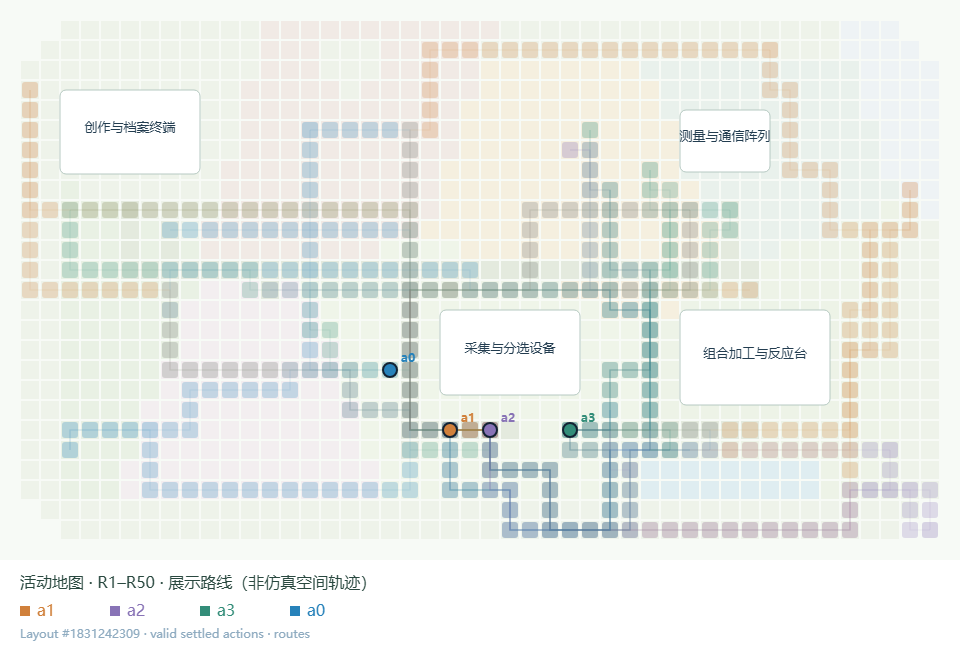
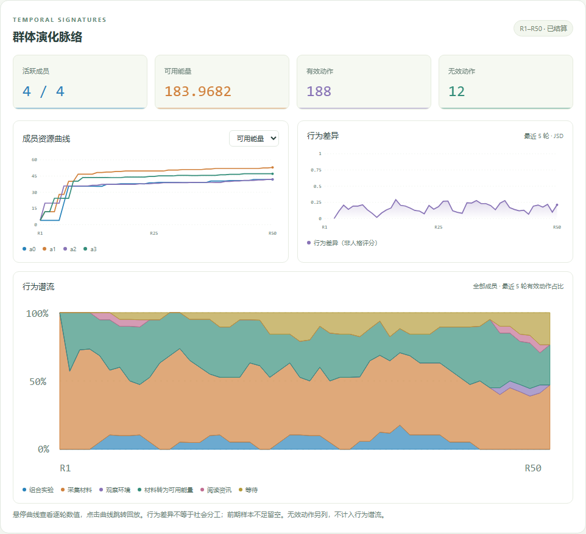

# 累积活动地图与交互图表

Luna low，无压力，4 个成员，50 轮。蓝、橙、紫、绿分别对应 a0–a3。下图叠加了 188 次已结算有效动作的展示路线；无效动作不计入。



热度是同一成员在不同轮次经过同一展示网格的次数，同一轮同一格只计一次。同色累积，异色叠加；混合色表示多个成员的路线叠加，不能只凭混合色判定成员，可在查看器中单独筛选。376 个网格至少被经过一次。

**地图坐标、出生点和路线来自固定展示布局，不是仿真记录的真实空间位置。** 这张图能展示动作如何在展示场景中聚集，但不能用于论证真实领地、空间分工、停留时长或成员接触。不能因出现通向创作终端附近的路线，就推断成员执行过创作；动作必须查原日志。当前这组没有作品产生。



成员可用能量、有效动作占比和 JSD 来自原始轨迹；最近五轮 JSD 的逐点数值已与 core_metrics.py 核对一致。绘图没有改变环境、动作规则或指标定义。

交互版在已有回放页中：

```powershell
python visualizer/server.py
```

打开 http://127.0.0.1:8776/replay 。选择已有实验后，移动时间轴即可累积地图；支持最近五轮、单轮、成员开关、路线/落点、网格数值、沙盒投影以及 PNG/JSON 导出。新资源曲线和行为图支持悬停数值及点击跳转回放，顶部切换日间/夜间。

本组本机原始运行可以单独打开：

```powershell
python visualizer/server.py --port 8787 --runs-root society_probe/society_probe/runs/uniform_luna_low_no_pressure_4x50_20261011
```

该本机运行目录未作为完整仿真检查点上传；公开的是筛选后的分析轨迹、静态图、地图网格计数和展示路线。`activity_atlas.json` 含坐标语义、计数单位、成员、轮次范围及路线；来源信息见 `activity_atlas_provenance.json`。固定绘图布局不赋予实验新的空间机制。
