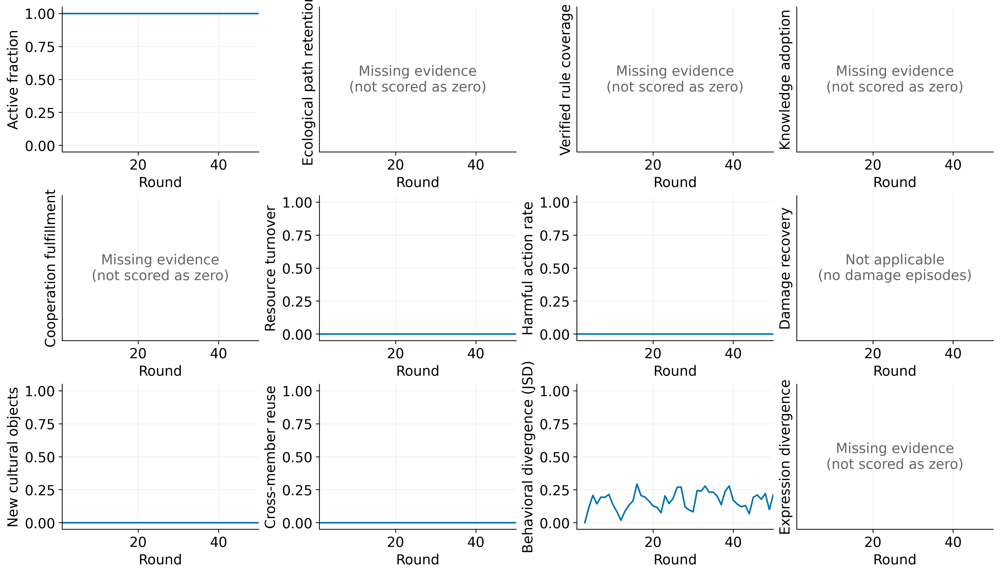
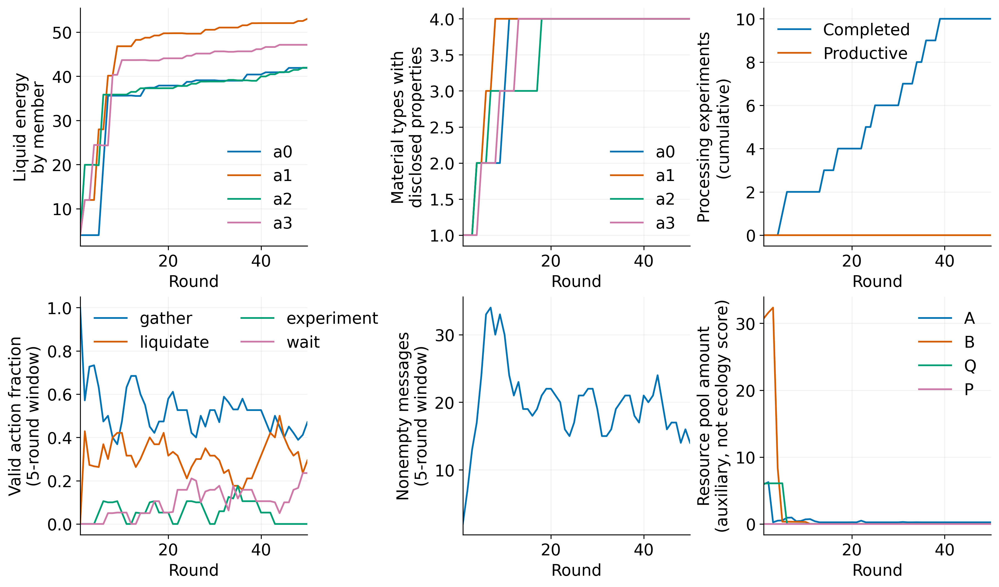

# Luna low：无压力组指标分析

4 个成员，50 轮；单个世界/运行种子。没有新增模型调用。





新增[累积活动地图与交互图表](ACTIVITY_ATLAS.md)：成员分色、轨迹叠加、资源曲线和行为谱流。地图使用展示坐标，不作为真实空间行为指标。

所有成员始终存活（200/200 成员轮）。这只表明本次无压力运行中的存续，不等于社会发展。

有效动作 188 次，无效 12 次。动作计数：`{'gather': 96, 'liquidate': 59, 'read_news': 2, 'experiment': 10, 'wait': 20, 'inspect': 1}`。
加工探索完成 10 次，产生新材料 0 次。

## 指标可计算性

|指标|最后一轮|证据状态|
|---|---|---|
|active_fraction|1.0|observed|
|ecological_path_retention|—|missing_evidence|
|verified_rule_coverage|—|missing_evidence|
|knowledge_adoption_coverage|—|missing_evidence|
|sustained_cooperation_fulfillment|—|missing_evidence|
|resource_turnover|0.0|absence_verified|
|harmful_action_rate|0.0|absence_verified|
|damage_recovery_rate|—|not_applicable|
|cultural_production_count|0|observed|
|cross_member_reuse_count|0|absence_verified|
|behavioral_divergence|0.2130119841854395|observed|
|expression_divergence|—|missing_evidence|

6 条数值曲线；恢复率不适用；另外 5 条缺少生态路径目录、已验证知识/采用链、双方确认承诺或语义编码。
零交易、零直接冲突由完整动作日志与已审查的非转移/非冲突接口集合确认。流通分母只验证液态资源正下界；尚未实现有转移时的完整资产账本。
作品复用为零，是因为本次没有任何作品或游戏对象。未把普通采集、材料衰减算作攻击。
行为差异使用最近 5 轮有效动作的两两 JSD（底数 2）；每位参与者至少 3 次动作。前期样本不足留空。它衡量行为分布差异，不是分工、人格或表达差异。
本次进入 JSD 计算的合格成员数在有值轮次为 3–4 人，逐点参与者名单和有效动作样本量见 metrics.json。
物性披露和资源池仅作为辅助过程量，不代替规则认知或生态持续性。没有调查问卷，也没有将未知项填为零。

## 离线复现

从仓库根目录运行（需要 Python 与 matplotlib）：

```powershell
python society_probe/society_probe/analyze_core_metrics.py --checkpoint results/luna_low_no_pressure_20261011/trajectory.json --config results/luna_low_no_pressure_20261011/config.json --output output/luna_metrics_reproduced
```

`trajectory.json` 是经过字段筛选的分析轨迹，不是可恢复执行的完整仿真检查点；原始输入哈希见 metrics.json。
单种子描述结果不能推断模型大小因果效应、所有模型缺乏内源需求或不存在组织。当前世界没有本次运行的 Lean 证书；不声称上述曲线是 Lean 证明的最优性评级。
