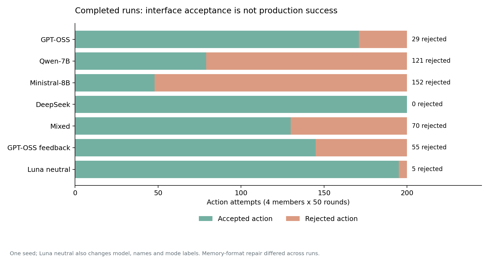
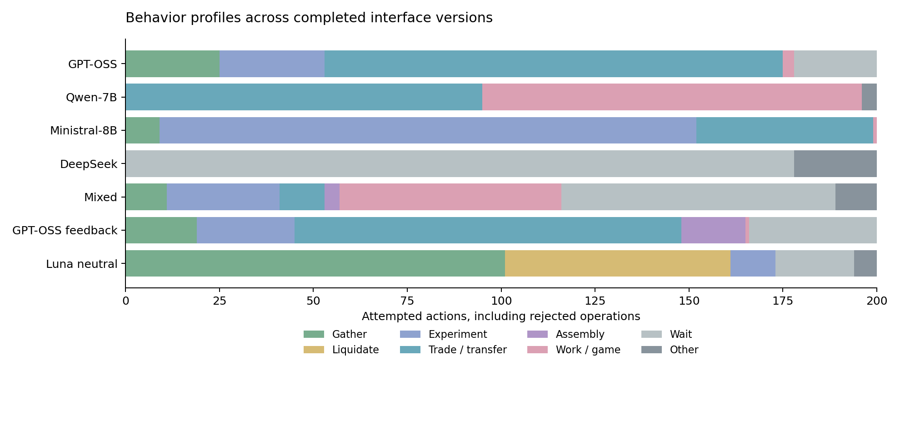

# Version comparison and known-recipe diagnostic

[简体中文](README.zh-CN.md) · [CSV](summary.csv) · [JSON and provenance](summary.json)

Fourteen completed real-model free runs, four members per run and 50 physical
rounds. Inactive members stop acting. Scripted demos and the goal-directed
diagnostic are excluded. Questionnaires are not used as organization evidence.

**No free run achieved productive processing or successful device assembly.
Luna produced materials in three legal actions after receiving the entry recipe
and an explicit execution goal.** Execution and autonomous discovery are distinct.

## Original pressured world

World-generation seed 2, simulation seed 7; old ecology/decay and integer inputs.

| Group | Final alive | Alive person-rounds / 200 | Productive / settled experiments | Rejected actions | Works |
|---|---:|---:|---:|---:|---:|
| GPT-OSS-20B | 0/4 | 32 | 0/0 | 6 | 0 |
| Qwen-7B | 0/4 | 32 | 0/0 | 0 | 0 |
| Luna low | 2/4 | 159 | 0/0 | 13 | 0 |
| DeepSeek Flash | 0/4 | 79 | 0/0 | 35 | 0 |
| Sol low | 4/4 | 200 | 0/16 | 3 | 0 |
| Mixed: OSS, Qwen, DeepSeek, Sol | 2/4 | 116 | 0/1 | 15 | 1 |

Sol survived and accumulated energy without productive discovery. Mixed survival
exceeded the corresponding homogeneous mean in this seed, but model assignment,
context and ecological/input bottlenecks prevent a causal heterogeneity claim.
See the [original report](../baseline_20261010/README.md).

## Revised physical world without pressure

These eight runs have identical complete `world` hashes: slower ecology,
reserve-funded precursor reseeding and decimal inputs. All finished with four
alive members and 200 alive person-rounds. Model/provider, labels, feedback and
memory-repair histories differ; these are descriptive comparisons.

| Group / interface | Rejected / 200 | Productive / settled experiments | Actual material gifts | Actual material trades | Works |
|---|---:|---:|---:|---:|---:|
| Luna low, Oct 11 interface | 12 | 0/10 | 0 | 0 | 0 |
| GPT-OSS, semantic modes / coarse feedback | 29 | 0/4 | 113 | 2 | 0 |
| Qwen-7B, semantic modes / coarse feedback | 121 | 0/0 | 0 | 0 | 46 |
| Ministral-8B, semantic modes / coarse feedback | 152 | 0/18 | 1 | 3 | 0 |
| DeepSeek, semantic modes / coarse feedback | 0 | 0/0 | 0 | 0 | 0 |
| Mixed: OSS, Qwen, Ministral, DeepSeek | 70 | 0/19 | 6 | 0 | 4 |
| GPT-OSS, semantic modes / detailed feedback | 55 | 0/19 | 0 | 24 | 0 |
| Luna, names / neutral modes / detailed feedback | 5 | 0/9 | 0 | 0 | 0 |

Trades are settled `accept_items` events; gifts are positive `give_item` events.
Quotes and rejected acceptances are excluded. Every group's successful assembly
count is zero, even when assembly attempts were legal.

- Detailed-feedback GPT-OSS recorded 24 trades and 19 settled experiments,
  versus 2 and 4 with coarse feedback. Rejections nevertheless rose from 29 to
  55 (+26, about 89.7%); rejection rates were 14.5% and 27.5%. No productive
  discovery followed. This is not evidence of overall or causal improvement.
- Neutral-interface Luna rejected 2.5% of actions, versus 6% for the prior Luna
  run, a 3.5 percentage-point difference under several simultaneous interface
  changes. It attempted each of three modes four times, but never A+B.
- DeepSeek waited in 178 of 200 actions: zero rejections do not imply development.
- Qwen produced 46 works, 27 at most eight characters long, with six valid
  informal-play actions and no executable game. Mixed produced four works.
  Counts alone do not establish quality or accumulated culture.
- Survival is uninformative here because every no-pressure run survived.
  Resource circulation and differing actions do not establish organization.

## Separate known-recipe execution diagnostic

Same physical world and initial assets. Luna controls a0; the other three
members wait. The recipe A:B=1:1 at F0/M1 is published, together with an explicit
goal to produce output. No starting materials are gifted.

| Step | Model action | Result |
|---|---|---|
| 1 | Gather 0.5 A | Material acquired |
| 2 | Gather 0.5 B | Material acquired |
| 3 | Process 0.4959344196 each of A and B at F0/M1 | 0.0537137639 C and 0.9918688393 W |

Three native calls, zero rejected actions, successful physical production.
The model used the decayed available balance to maintain the ratio. An offline
positive control independently checked a legal production path first.
[Model diagnostic](known_recipe_diagnostic.json) ·
[Physical control](known_recipe_positive_control.json).

This supports instruction-following execution in the tested fresh state. It does
not establish execution by every model, voluntary adoption without a goal,
knowledge propagation or organization. It is excluded from free-run counts.

The next informative contrast is recipe disclosure without an assigned task,
against no disclosure at matched states, followed by measured adoption and
coordination. Single-seed differences are not significance or model-size claims.
Missing verified-rule, adoption and organizational evidence is not scored as
zero. Behavioral entropy is not thermodynamic entropy. Native USD is unknown;
external API cost zero is not free. Runtime survival witnesses are not new Lean
certificates. Local raw logs retain repair/retry provenance.

Recompute with `python society_probe/society_probe/summarize_recent_versions.py`
and local raw checkpoints. This report publishes aggregates, hashes and plots;
host CLI context, credentials and private budget ledgers are excluded.
