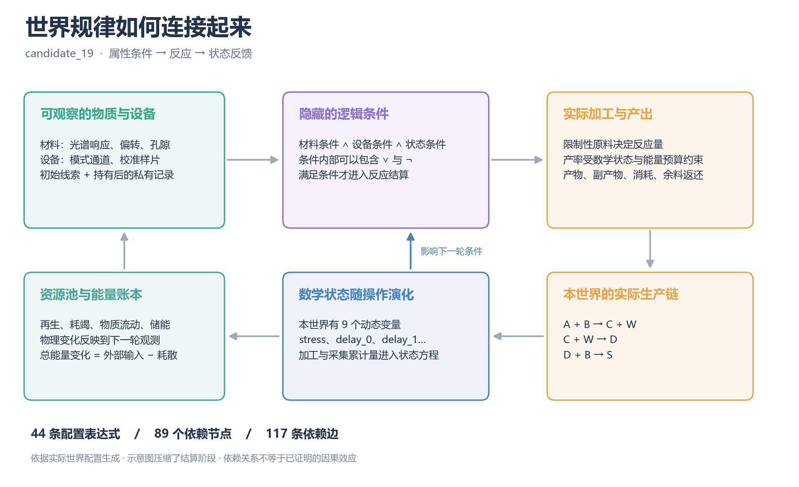

# World equations and dependency networks

These examples are generated from executable configurations, without model calls.

| World | Mechanisms | Expressions | Nodes | Edges |
|---|---:|---:|---:|---:|
| [Alternative, seed 19](alternative_seed19/model.md) | 8 | 44 | 89 | 117 |
| [Ecological interdependence, seed 31](ecology_interdependence_seed31/model.md) | 4 | 26 | 61 | 83 |
| [Catalysis and repair, seed 47](catalysis_repair_seed47/model.md) | 5 | 29 | 61 | 104 |
| [All 20 mechanisms, seed 23](full20_seed23/model.md) | 20 | 93 | 167 | 327 |

Each folder contains the stage-composition model, expanded configuration equations,
LaTeX, a Mermaid dependency graph, machine-readable equations and edges, the full
physical definition, and hashes. Generated model notes and figure headings use
Chinese; equation symbols and network identifiers remain machine-readable.



[8-mechanism full network](alternative_seed19/network.svg) · [20-mechanism full network](full20_seed23/network.svg)

The top-level transition composes round initialization, communication, ordered
actions, physical settlement, maintenance, and conversation cleanup. Underlying
state updates, regeneration, depletion, reaction guards/yields/costs/effects,
material-use effects, measurement bias, and pool flows are expanded from the
configuration. Social tools retain their implementation-defined branches.

This is a static dependency network, not a causal-effect estimate, a closed-form
solution, or a Lean proof graph. Finite property consistency does not establish
survival or discoverability. Initial property descriptions are idealized probe
readings. Limiting-reagent settlement is outside the current composed Lean compiler.

Export another validated configuration from the repository root:

```bash
python society_probe/society_probe/world_math_export.py --config CONFIG.json --output output/world_math
python -m pip install -r requirements-figures.txt
python society_probe/society_probe/render_world_math.py --root output/world_math
```

See the [property specification](../../PROPERTY_RULES.en.md) and [Chinese index](README.md).
