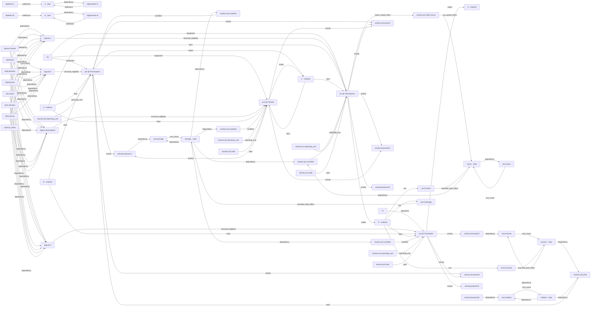

# candidate_47：世界模型与依赖网络

本文件由实际配置生成。目标是表达同一个完整世界状态的转移与守恒关系，并展开配置中的逻辑条件、反应和动力学方程；不是闭式解或新的证明。

世界定义 SHA256：`7e03507463b37afccaf5c53023fafaac8581c7cc022be3f26c7c6d203cf76fb3`。

## 总转移算子

完整状态包含库存、液态能量、活性、资源池、设备、队列、储存、沟通与作品记录。每轮算子按实际代码顺序组合：轮次初始化、通信、物理动作、物理结算、维护、会话清理。

$$\boxed{\mathcal S_{t+1}=\mathcal C_\theta\circ\mathcal M_\theta\circ\mathcal P_\theta\circ\mathcal A_{\theta,\sigma_t}\circ\mathcal D_\theta\circ\mathcal B_\theta(\mathcal S_t;\mathbf a_t,\mathbf m_t,\boldsymbol\xi_t),\qquad o_{i,t}=\mathcal O_{\theta,i}(\mathcal S_t)}$$

这里的阶段算子是代码定义的转移，不把社会行为假装成预设优化目标。观察发生在对应决策阶段；通信过程中状态和消息也会更新。动作顺序、排队、衰变和噪声不能因写成一个大公式而省略。

## 反应与能量预算

$$\Phi_r(\mathbf p,\mathbf f)\land g_r(c_t)\land\operatorname{served}_r\land\operatorname{funded}_r\ \Longrightarrow\ \operatorname{execute}_r.$$

还需满足未在队列中损坏、设备最低加工量和能力要求。下式是成功结算分支；失败与等待分支保持代码语义。

$$\lambda_r=\min_{k\in I_r}\frac{u_{rk}}{\nu_{rk}},\quad c_{rk}=\nu_{rk}\lambda_r,\quad u^{\mathrm{return}}_{rk}=u_{rk}-c_{rk}.$$

$$K_r=\max\{0,k_r(c_t)\}\lambda_r,\quad B_r=\sum_k e_k c_{rk}+K_r,\quad Y_r=\min\left\{\max\{0,y_r(c_t)\}\lambda_r\xi_r,\frac{B_r}{e_{\mathrm{out}(r)}}\right\}.$$

主产物先结算，副产物依声明顺序使用剩余预算。旧整数语义还要向下取整；等待队列中的材料继续按原规则衰变。

$$Y_{rb}=\min\left\{\max\{0,y_{rb}(c_t)\}\lambda_r,\frac{B_r-e_{\mathrm{out}(r)}Y_r-\sum_{j\prec b}e_jY_{rj}}{e_b}\right\}.$$

副产物式中左侧对应当前副产物，求和仅取此前已结算的副产物。实际系数、条件与效应在下方逐项展开。

## 物理结算顺序

反应累计效应先裁剪到状态边界，再用同一上下文同步更新所有状态变量；随后生态消耗、回收、按声明顺序资源流动、外部补给与储备受限再生，最后衰变和报价到期返还。

$$\bar s_j=\operatorname{clip}_{[l_j,h_j]}\left(s_j+\sum_r\lambda_r\Delta_{rj}(c_t)\right),\quad s_j^+=\operatorname{clip}_{[l_j,h_j]}f_j(\bar{\mathbf s},\mathbf p,\boldsymbol\alpha_t).$$

$$d_k=\min\{p_k,\max(0,\delta_k(c^+))\},\quad \tilde p_k=p_k-d_k,\quad E^{\mathrm{recycle}}=\sum_ke_k\rho_kd_k.$$

$$q_k=e_k\min\{\max(0,g_k(c^{\mathrm{flow}})),P_k-p_k^{\mathrm{flow}}\},\quad \eta=\begin{cases}\min(1,R^{\mathrm{available}}/\sum_kq_k),&\sum_kq_k>0,\\0,&\text{otherwise},\end{cases}\quad p_k^{\mathrm{regen}}=p_k^{\mathrm{flow}}+\eta q_k/e_k.$$

容量裁剪、衰变和流动损失计入耗散；储存保护可能修改某个容器的实际衰变率。

$$\boxed{\mathcal E_{t+1}-\mathcal E_t=I_t-D_t,\quad D_t\ge0,\quad \mathcal E_t=\mathcal E_{\mathrm{liquid}}+\mathcal E_{\mathrm{materials}}+\mathcal E_{\mathrm{reserve}}+\mathcal E_{\mathrm{escrow}}+\mathcal E_{\mathrm{devices}}.}$$

总能量账本涵盖活跃与不活跃成员、储存、交易与游戏托管、等待加工材料及设备嵌入能量；活性不是物理能量。守恒残差允许浮点误差。该账本不等于社会福利或组织最优。

## 配置方程完整展开

以下引用符号取其所在结算阶段的上下文，不应把所有 state/pool 引用机械解释为同一时刻。

### next.stress

$$\mathrm{next.stress}=\operatorname{max}\left(0,\left(\mathrm{state.stress} - 0.5\right)\right)$$

### next.enzyme

$$\mathrm{next.enzyme}=\operatorname{clamp}\left(\left(\left(0.95 \cdot \mathrm{state.enzyme}\right) + \mathrm{activity.consumed.D}\right),0,4\right)$$

### next.inhibitor

$$\mathrm{next.inhibitor}=\operatorname{clamp}\left(\left(\left(0.8 \cdot \mathrm{state.inhibitor}\right) + \mathrm{activity.harvested.B}\right),0,20\right)$$

### next.damage

$$\mathrm{next.damage}=\operatorname{clamp}\left(\left(\mathrm{state.damage} + \left(0.1 \cdot \mathrm{activity.produced.C}\right)\right),0,2\right)$$

### regeneration.A

$$\mathrm{regeneration.A}=\left(\left(0.1 \cdot \left(0.25 \cdot \mathrm{pool.A} \cdot \operatorname{max}\left(0,\left(1 - \frac{\mathrm{pool.A}}{60}\right)\right)\right)\right) + \left(0.25 \cdot \operatorname{max}\left(0,\left(1 - \frac{\mathrm{pool.A}}{60}\right)\right)\right)\right)$$

### depletion.A

$$\mathrm{depletion.A}=0$$

### regeneration.B

$$\mathrm{regeneration.B}=\left(0.1 \cdot \left(0.25 \cdot \mathrm{pool.B} \cdot \operatorname{max}\left(0,\left(1 - \frac{\mathrm{pool.B}}{60}\right)\right)\right)\right)$$

### depletion.B

$$\mathrm{depletion.B}=0$$

### reaction.pr0.condition

$$\mathrm{reaction.pr0.condition}=\left(1 \land \left(\mathrm{state.damage} < 1\right)\right)$$

### reaction.pr0.yield

$$\mathrm{reaction.pr0.yield}=\frac{\left(1.5 \cdot \frac{\left(2 \cdot \mathrm{state.enzyme}\right)}{\left(1 + \mathrm{state.enzyme} + \mathrm{state.inhibitor}\right)}\right)}{2}$$

### reaction.pr0.operating_cost

$$\mathrm{reaction.pr0.operating\_cost}=0.5$$

### reaction.pr1.condition

$$\mathrm{reaction.pr1.condition}=\left(\left(\mathrm{state.stress} < 10\right) \land \left(\mathrm{state.damage} < 1\right)\right)$$

### reaction.pr1.yield

$$\mathrm{reaction.pr1.yield}=1.6666666666666667$$

### reaction.pr1.operating_cost

$$\mathrm{reaction.pr1.operating\_cost}=0$$

### reaction.pr1.effect.stress

$$\mathrm{reaction.pr1.effect.stress}=1$$

### reaction.pr2.condition

$$\mathrm{reaction.pr2.condition}=\left(1 \land \left(\mathrm{state.damage} < 1\right)\right)$$

### reaction.pr2.yield

$$\mathrm{reaction.pr2.yield}=1.35$$

### reaction.pr2.operating_cost

$$\mathrm{reaction.pr2.operating\_cost}=1$$

### reaction.pr3.condition

$$\mathrm{reaction.pr3.condition}=\left(1 \land \left(\mathrm{state.damage} < 1\right)\right)$$

### reaction.pr3.yield

$$\mathrm{reaction.pr3.yield}=1.6666666666666665$$

### reaction.pr3.operating_cost

$$\mathrm{reaction.pr3.operating\_cost}=0$$

### logical.r0

$$\mathrm{logical.r0}=\left(\left(\mathrm{device.channel} = 1457\right) \land \left(\left(\mathrm{slot0.band} = 1\right) \land \left(\left(\mathrm{slot0.direction} = 1\right) \lor \left(\left(\mathrm{slot0.direction} = 0\right) \land \left(\mathrm{slot0.porous} = \top\right)\right)\right)\right) \land \left(\left(\mathrm{slot1.band} = 1\right) \land \left(\left(\mathrm{slot1.direction} = -1\right) \lor \left(\left(\mathrm{slot1.direction} = 0\right) \land \left(\mathrm{slot1.porous} = \top\right)\right)\right)\right)\right)$$

### logical.r1

$$\mathrm{logical.r1}=\left(\left(\mathrm{device.channel} = 1457\right) \land \left(\left(\mathrm{slot0.band} = 27\right) \land \left(\left(\mathrm{slot0.direction} = 1\right) \lor \left(\left(\mathrm{slot0.direction} = 0\right) \land \left(\mathrm{slot0.porous} = \top\right)\right)\right)\right) \land \left(\left(\mathrm{slot1.band} = 1\right) \land \left(\left(\mathrm{slot1.direction} = 1\right) \lor \left(\left(\mathrm{slot1.direction} = 0\right) \land \left(\mathrm{slot1.porous} = \top\right)\right)\right)\right)\right)$$

### logical.r2

$$\mathrm{logical.r2}=\left(\left(\mathrm{device.channel} = 6125\right) \land \left(\left(\mathrm{slot0.band} = 24\right) \land \left(\left(\mathrm{slot0.direction} = 1\right) \lor \left(\left(\mathrm{slot0.direction} = 0\right) \land \left(\mathrm{slot0.porous} = \top\right)\right)\right)\right) \land \left(\left(\mathrm{slot1.band} = 1\right) \land \left(\left(\mathrm{slot1.direction} = -1\right) \lor \left(\left(\mathrm{slot1.direction} = 0\right) \land \left(\mathrm{slot1.porous} = \top\right)\right)\right)\right)\right)$$

### logical.autocatalysis

$$\mathrm{logical.autocatalysis}=\left(\left(\mathrm{device.channel} = 9491\right) \land \left(\left(\mathrm{slot0.band} = 1\right) \land \left(\left(\mathrm{slot0.direction} = 1\right) \lor \left(\left(\mathrm{slot0.direction} = 0\right) \land \left(\mathrm{slot0.porous} = \top\right)\right)\right)\right) \land \left(\left(\mathrm{slot1.band} = 27\right) \land \left(\left(\mathrm{slot1.direction} = 1\right) \lor \left(\left(\mathrm{slot1.direction} = 0\right) \land \left(\mathrm{slot1.porous} = \top\right)\right)\right)\right)\right)$$

### external_inflow

$$\mathrm{external\_inflow}=40$$

### use.D.stress

$$\mathrm{use.D.stress}=-1$$

### use.D.enzyme

$$\mathrm{use.D.enzyme}=1$$

### use.D.damage

$$\mathrm{use.D.damage}=-0.5$$

## 反应投料及边界

| 反应 | 设备 / 模式 | 投料系数 | 主产物 |
|---|---|---|---|
| pr0 | F0 / compress | {"A": 1, "B": 1} | C |
| pr1 | F0 / compress | {"C": 3, "A": 1} | D |
| pr2 | F1 / combine | {"D": 2, "B": 1} | S |
| pr3 | F0 / seed | {"A": 2, "C": 1} | C |

精确初始值、状态上下界、资源容量、衰减率、全部功能与设备配置见 [definition.json](definition.json)。

## 依赖网络

下面展示实际配置的静态依赖关系。边不代表已证明的因果效应；反馈环允许存在。

## 覆盖边界

已展开：全部状态更新、资源池再生/消耗、反应条件/产率/成本/副产物/状态效应、材料使用效应、测量偏差、资源流动速率与逻辑前提。噪声、储存、组合功能、设备和调度参数保留在机器可读完整定义中；社会动作与每种工具的分支转移通过实际阶段实现定义，没有逐条改写成闭式标量方程。属性逻辑图是条件网络，不是Lean证明网络。
