# candidate_23：世界模型与依赖网络

本文件由实际配置生成。目标是表达同一个完整世界状态的转移与守恒关系，并展开配置中的逻辑条件、反应和动力学方程；不是闭式解或新的证明。

世界定义 SHA256：`7e755930373d5e56cd913e8710efa66eb8d69cf22f381d8eded5150d27c35a16`。

## 总转移算子

完整状态包含库存、液态能量、活性、资源池、设备、队列、储存、沟通与作品记录。每轮算子按实际代码顺序组合：轮次初始化、通信、物理动作、物理结算、维护、会话清理。

$$\boxed{\mathcal S_{t+1}=\mathcal C_\theta\circ\mathcal M_\theta\circ\mathcal P_\theta\circ\mathcal A_{\theta,\sigma_t}\circ\mathcal D_\theta\circ\mathcal B_\theta(\mathcal S_t;\mathbf a_t,\mathbf m_t,\boldsymbol\xi_t),\qquad o_{i,t}=\mathcal O_{\theta,i}(\mathcal S_t)}$$

这里的阶段算子是代码定义的转移，不把社会行为假装成预设优化目标。观察发生在对应决策阶段；通信过程中状态和消息也会更新。动作顺序、排队、衰变和噪声不能因写成一个大公式而省略。

## 反应与能量预算

$$\Phi_r(\mathbf p,\mathbf f)\land g_r(c_t)\land\operatorname{served}_r\land\operatorname{funded}_r\ \Longrightarrow\ \operatorname{execute}_r.$$

还需满足未在队列中损坏、设备最低加工量和能力要求。下式是成功结算分支；失败与等待分支保持代码语义。

$$\lambda_r=\min_{k\in I_r}\frac{u_{rk}}{\nu_{rk}},\quad c_{rk}=\nu_{rk}\lambda_r,\quad u^{\mathrm{return}}_{rk}=u_{rk}-c_{rk}.$$

$$K_r=\max\{0,k_r(c_t)\}\lambda_r,\quad B_r=\sum_k e_k c_{rk}+K_r,\quad Y_r=\min\left\{\max\{0,y_r(c_t)\}\lambda_r\xi_r,\frac{B_r}{e_{\mathrm{out}(r)}}\right\}.$$

主产物先结算，副产物依声明顺序使用剩余预算。旧整数语义还要向下取整；等待队列中的材料继续按原规则衰变。

$$Y_{rb}=\min\left\{\max\{0,y_{rb}(c_t)\}\lambda_r,\frac{B_r-e_{\mathrm{out}(r)}Y_r-\sum_{j\prec b}e_jY_{rj}}{e_b}\right\}.$$

副产物式中左侧对应当前副产物，求和仅取此前已结算的副产物。实际系数、条件与效应在下方逐项展开。

## 物理结算顺序

反应累计效应先裁剪到状态边界，再用同一上下文同步更新所有状态变量；随后生态消耗、回收、按声明顺序资源流动、外部补给与储备受限再生，最后衰变和报价到期返还。

$$\bar s_j=\operatorname{clip}_{[l_j,h_j]}\left(s_j+\sum_r\lambda_r\Delta_{rj}(c_t)\right),\quad s_j^+=\operatorname{clip}_{[l_j,h_j]}f_j(\bar{\mathbf s},\mathbf p,\boldsymbol\alpha_t).$$

$$d_k=\min\{p_k,\max(0,\delta_k(c^+))\},\quad \tilde p_k=p_k-d_k,\quad E^{\mathrm{recycle}}=\sum_ke_k\rho_kd_k.$$

$$q_k=e_k\min\{\max(0,g_k(c^{\mathrm{flow}})),P_k-p_k^{\mathrm{flow}}\},\quad \eta=\begin{cases}\min(1,R^{\mathrm{available}}/\sum_kq_k),&\sum_kq_k>0,\\0,&\text{otherwise},\end{cases}\quad p_k^{\mathrm{regen}}=p_k^{\mathrm{flow}}+\eta q_k/e_k.$$

容量裁剪、衰变和流动损失计入耗散；储存保护可能修改某个容器的实际衰变率。

$$\boxed{\mathcal E_{t+1}-\mathcal E_t=I_t-D_t,\quad D_t\ge0,\quad \mathcal E_t=\mathcal E_{\mathrm{liquid}}+\mathcal E_{\mathrm{materials}}+\mathcal E_{\mathrm{reserve}}+\mathcal E_{\mathrm{escrow}}+\mathcal E_{\mathrm{devices}}.}$$

总能量账本涵盖活跃与不活跃成员、储存、交易与游戏托管、等待加工材料及设备嵌入能量；活性不是物理能量。守恒残差允许浮点误差。该账本不等于社会福利或组织最优。

## 配置方程完整展开

以下引用符号取其所在结算阶段的上下文，不应把所有 state/pool 引用机械解释为同一时刻。

### next.stress

$$\mathrm{next.stress}=\operatorname{max}\left(0,\left(\mathrm{state.stress} - 0.5\right)\right)$$

### next.substrate

$$\mathrm{next.substrate}=\operatorname{clamp}\left(\left(\left(0.5 \cdot \mathrm{state.substrate}\right) + \mathrm{activity.consumed.A}\right),0,100\right)$$

### next.enzyme

$$\mathrm{next.enzyme}=\operatorname{clamp}\left(\left(\left(0.95 \cdot \mathrm{state.enzyme}\right) + \mathrm{activity.consumed.C}\right),0,4\right)$$

### next.inhibitor

$$\mathrm{next.inhibitor}=\operatorname{clamp}\left(\left(\left(0.8 \cdot \mathrm{state.inhibitor}\right) + \mathrm{activity.harvested.B}\right),0,20\right)$$

### next.toggle_x

$$\mathrm{next.toggle\_x}=\operatorname{clamp}\left(\left(\left(0.8 \cdot \mathrm{state.toggle\_x}\right) + \frac{0.6}{\left(1 + {\mathrm{state.toggle\_y}}^{2}\right)}\right),0,4\right)$$

### next.toggle_y

$$\mathrm{next.toggle\_y}=\operatorname{clamp}\left(\left(\left(0.8 \cdot \mathrm{state.toggle\_y}\right) + \frac{0.6}{\left(1 + {\mathrm{state.toggle\_x}}^{2}\right)}\right),0,4\right)$$

### next.delay_0

$$\mathrm{next.delay\_0}=\mathrm{activity.harvested.A}$$

### next.delay_1

$$\mathrm{next.delay\_1}=\mathrm{state.delay\_0}$$

### next.delay_2

$$\mathrm{next.delay\_2}=\mathrm{state.delay\_1}$$

### next.chaos_z

$$\mathrm{next.chaos\_z}=\left(4 \cdot \mathrm{state.chaos\_z} \cdot \left(1 - \mathrm{state.chaos\_z}\right)\right)$$

### next.rd_x0

$$\mathrm{next.rd\_x0}=\operatorname{clamp}\left(\left(\mathrm{state.rd\_x0} + \left(0.1 \cdot \left(\frac{1}{\left(1 + {\mathrm{state.rd\_y0}}^{2}\right)} - \mathrm{state.rd\_x0}\right)\right) + \left(0.1 \cdot \left(\left(\mathrm{state.rd\_x1} - \mathrm{state.rd\_x0}\right)\right)\right)\right),0,4\right)$$

### next.rd_y0

$$\mathrm{next.rd\_y0}=\operatorname{clamp}\left(\left(\mathrm{state.rd\_y0} + \left(0.1 \cdot \left(\frac{1}{\left(1 + {\mathrm{state.rd\_x0}}^{2}\right)} - \mathrm{state.rd\_y0}\right)\right) + \left(0.025 \cdot \left(\left(\mathrm{state.rd\_y1} - \mathrm{state.rd\_y0}\right)\right)\right)\right),0,4\right)$$

### next.rd_x1

$$\mathrm{next.rd\_x1}=\operatorname{clamp}\left(\left(\mathrm{state.rd\_x1} + \left(0.1 \cdot \left(\frac{1}{\left(1 + {\mathrm{state.rd\_y1}}^{2}\right)} - \mathrm{state.rd\_x1}\right)\right) + \left(0.1 \cdot \left(\left(\mathrm{state.rd\_x0} - \mathrm{state.rd\_x1}\right) + \left(\mathrm{state.rd\_x2} - \mathrm{state.rd\_x1}\right)\right)\right)\right),0,4\right)$$

### next.rd_y1

$$\mathrm{next.rd\_y1}=\operatorname{clamp}\left(\left(\mathrm{state.rd\_y1} + \left(0.1 \cdot \left(\frac{1}{\left(1 + {\mathrm{state.rd\_x1}}^{2}\right)} - \mathrm{state.rd\_y1}\right)\right) + \left(0.025 \cdot \left(\left(\mathrm{state.rd\_y0} - \mathrm{state.rd\_y1}\right) + \left(\mathrm{state.rd\_y2} - \mathrm{state.rd\_y1}\right)\right)\right)\right),0,4\right)$$

### next.rd_x2

$$\mathrm{next.rd\_x2}=\operatorname{clamp}\left(\left(\mathrm{state.rd\_x2} + \left(0.1 \cdot \left(\frac{1}{\left(1 + {\mathrm{state.rd\_y2}}^{2}\right)} - \mathrm{state.rd\_x2}\right)\right) + \left(0.1 \cdot \left(\left(\mathrm{state.rd\_x1} - \mathrm{state.rd\_x2}\right)\right)\right)\right),0,4\right)$$

### next.rd_y2

$$\mathrm{next.rd\_y2}=\operatorname{clamp}\left(\left(\mathrm{state.rd\_y2} + \left(0.1 \cdot \left(\frac{1}{\left(1 + {\mathrm{state.rd\_x2}}^{2}\right)} - \mathrm{state.rd\_y2}\right)\right) + \left(0.025 \cdot \left(\left(\mathrm{state.rd\_y1} - \mathrm{state.rd\_y2}\right)\right)\right)\right),0,4\right)$$

### next.damage

$$\mathrm{next.damage}=\operatorname{clamp}\left(\left(\mathrm{state.damage} + \left(0.1 \cdot \mathrm{activity.produced.C}\right)\right),0,2\right)$$

### next.buffer_capacity

$$\mathrm{next.buffer\_capacity}=\operatorname{max}\left(0,\left(\mathrm{state.buffer\_capacity} - \operatorname{min}\left(\mathrm{pool.P},\mathrm{state.buffer\_capacity}\right)\right)\right)$$

### next.buffer_applied

$$\mathrm{next.buffer\_applied}=\operatorname{min}\left(\mathrm{pool.P},\mathrm{state.buffer\_capacity}\right)$$

### next.storage_phase

$$\mathrm{next.storage\_phase}=\left(1 - \mathrm{state.storage\_phase}\right)$$

### next.conductance_1

$$\mathrm{next.conductance\_1}=\mathrm{state.conductance\_1}$$

### next.conductance_2

$$\mathrm{next.conductance\_2}=\mathrm{state.conductance\_2}$$

### next.calibration

$$\mathrm{next.calibration}=\mathrm{state.calibration}$$

### regeneration.A

$$\mathrm{regeneration.A}=\left(\left(0.1 \cdot \frac{\operatorname{max}\left(0,\left(\left(0.25 \cdot \mathrm{pool.A} \cdot \operatorname{max}\left(0,\left(1 - \frac{\mathrm{pool.A}}{60}\right)\right)\right) \cdot \left(\frac{\mathrm{pool.B}}{\left(\mathrm{pool.B} + 15\right)} \cdot 4 \cdot \frac{\mathrm{pool.A}}{60} \cdot \operatorname{max}\left(0,\left(1 - \frac{\mathrm{pool.A}}{60}\right)\right)\right) \cdot \left(\frac{\mathrm{pool.A}}{6} - 1\right)\right)\right)}{\left(1 + \left(0.1 \cdot \mathrm{state.delay\_2}\right)\right)}\right) + \left(0.25 \cdot \operatorname{max}\left(0,\left(1 - \frac{\mathrm{pool.A}}{60}\right)\right)\right)\right)$$

### depletion.A

$$\mathrm{depletion.A}=\left(0.1 \cdot \left(\left(0.05 \cdot \mathrm{pool.A} \cdot \frac{15}{\left(\mathrm{pool.B} + 15\right)}\right) + \operatorname{max}\left(0,\left(0 - \left(\left(0.25 \cdot \mathrm{pool.A} \cdot \operatorname{max}\left(0,\left(1 - \frac{\mathrm{pool.A}}{60}\right)\right)\right) \cdot \left(\frac{\mathrm{pool.B}}{\left(\mathrm{pool.B} + 15\right)} \cdot 4 \cdot \frac{\mathrm{pool.A}}{60} \cdot \operatorname{max}\left(0,\left(1 - \frac{\mathrm{pool.A}}{60}\right)\right)\right) \cdot \left(\frac{\mathrm{pool.A}}{6} - 1\right)\right)\right)\right)\right)\right)$$

### regeneration.B

$$\mathrm{regeneration.B}=\left(0.1 \cdot \left(\operatorname{max}\left(0,\left(0.25 \cdot \mathrm{pool.B} \cdot \operatorname{max}\left(0,\left(1 - \frac{\mathrm{pool.B}}{60}\right)\right) \cdot \left(\frac{\mathrm{pool.B}}{6} - 1\right)\right)\right) \cdot \left(0.2 + \left(0.8 \cdot \mathrm{state.chaos\_z}\right)\right)\right)\right)$$

### depletion.B

$$\mathrm{depletion.B}=\left(0.1 \cdot \left(\left(0.2 \cdot \mathrm{pool.A} \cdot \frac{\mathrm{pool.B}}{\left(\mathrm{pool.B} + 15\right)}\right) + \operatorname{max}\left(0,\left(0 - \left(0.25 \cdot \mathrm{pool.B} \cdot \operatorname{max}\left(0,\left(1 - \frac{\mathrm{pool.B}}{60}\right)\right) \cdot \left(\frac{\mathrm{pool.B}}{6} - 1\right)\right)\right)\right)\right)\right)$$

### regeneration.Q

$$\mathrm{regeneration.Q}=0$$

### depletion.Q

$$\mathrm{depletion.Q}=\left(0.5 \cdot \mathrm{activity.produced.C}\right)$$

### regeneration.W

$$\mathrm{regeneration.W}=0$$

### depletion.W

$$\mathrm{depletion.W}=0$$

### regeneration.P

$$\mathrm{regeneration.P}=0$$

### depletion.P

$$\mathrm{depletion.P}=0$$

### regeneration.P_bound

$$\mathrm{regeneration.P\_bound}=0$$

### depletion.P_bound

$$\mathrm{depletion.P\_bound}=0$$

### regeneration.P_neutral

$$\mathrm{regeneration.P\_neutral}=0$$

### depletion.P_neutral

$$\mathrm{depletion.P\_neutral}=0$$

### regeneration.BAT

$$\mathrm{regeneration.BAT}=0$$

### depletion.BAT

$$\mathrm{depletion.BAT}=0$$

### regeneration.NET

$$\mathrm{regeneration.NET}=0$$

### depletion.NET

$$\mathrm{depletion.NET}=0$$

### reaction.pr0.condition

$$\mathrm{reaction.pr0.condition}=\left(1 \land \left(\mathrm{state.damage} < 1\right)\right)$$

### reaction.pr0.yield

$$\mathrm{reaction.pr0.yield}=\left(1.3333333333333333 \cdot \operatorname{max}\left(0,\left(1 - \frac{2}{\operatorname{max}\left(2,\mathrm{pool.Q}\right)}\right)\right) \cdot \frac{\left(4 \cdot \mathrm{state.substrate}\right)}{\left(1 + \mathrm{state.substrate} + \frac{{\mathrm{state.substrate}}^{2}}{4}\right)} \cdot \frac{\left(2 \cdot \mathrm{state.enzyme}\right)}{\left(1 + \mathrm{state.enzyme} + \mathrm{state.inhibitor}\right)} \cdot \frac{\left(1 + \mathrm{state.toggle\_x}\right)}{\left(2 + \mathrm{state.toggle\_x} + \mathrm{state.toggle\_y}\right)} \cdot \frac{1}{\left(1 + \mathrm{state.rd\_y0}\right)} \cdot \frac{1}{\left(1 + \left(0.1 \cdot \mathrm{pool.P}\right)\right)} \cdot \left(0.5 + \frac{\left(\mathrm{state.conductance\_1} \cdot \mathrm{state.conductance\_2}\right)}{\operatorname{max}\left(1e-06,\left(\mathrm{state.conductance\_1} + \mathrm{state.conductance\_2}\right)\right)}\right)\right)$$

### reaction.pr0.operating_cost

$$\mathrm{reaction.pr0.operating\_cost}=\left(2 + 0.2 + \left(0.3 \cdot \mathrm{activity.submitted.F0}\right)\right)$$

### reaction.pr0.byproduct.W

$$\mathrm{reaction.pr0.byproduct.W}=2$$

### reaction.pr1.condition

$$\mathrm{reaction.pr1.condition}=\left(\left(\mathrm{state.stress} < 10\right) \land \left(\mathrm{state.damage} < 1\right)\right)$$

### reaction.pr1.yield

$$\mathrm{reaction.pr1.yield}=\frac{\left(2 \cdot \frac{1}{\left(1 + \mathrm{state.rd\_y2}\right)}\right)}{4}$$

### reaction.pr1.operating_cost

$$\mathrm{reaction.pr1.operating\_cost}=\frac{\left(4 + 0.2 + \left(0.3 \cdot \mathrm{activity.submitted.F1}\right)\right)}{4}$$

### reaction.pr1.effect.stress

$$\mathrm{reaction.pr1.effect.stress}=\frac{1}{4}$$

### reaction.pr2.condition

$$\mathrm{reaction.pr2.condition}=\left(1 \land \left(\mathrm{state.damage} < 1\right)\right)$$

### reaction.pr2.yield

$$\mathrm{reaction.pr2.yield}=\left(0.5833333333333334 \cdot \frac{1}{\left(1 + \mathrm{state.rd\_y2}\right)}\right)$$

### reaction.pr2.operating_cost

$$\mathrm{reaction.pr2.operating\_cost}=\left(2 + 0.2 + \left(0.3 \cdot \mathrm{activity.submitted.F1}\right)\right)$$

### reaction.pr3.condition

$$\mathrm{reaction.pr3.condition}=\left(1 \land \left(\mathrm{state.damage} < 1\right)\right)$$

### reaction.pr3.yield

$$\mathrm{reaction.pr3.yield}=\left(1.6666666666666665 \cdot \frac{1}{\left(1 + \mathrm{state.rd\_y0}\right)}\right)$$

### reaction.pr3.operating_cost

$$\mathrm{reaction.pr3.operating\_cost}=\left(0 + 0.2 + \left(0.3 \cdot \mathrm{activity.submitted.F0}\right)\right)$$

### reaction.pr4.condition

$$\mathrm{reaction.pr4.condition}=\left(1 \land \left(\mathrm{state.damage} < 1\right)\right)$$

### reaction.pr4.yield

$$\mathrm{reaction.pr4.yield}=\left(1.3333333333333333 \cdot \operatorname{max}\left(0,\left(1 - \frac{2}{\operatorname{max}\left(2,\mathrm{pool.Q}\right)}\right)\right) \cdot \frac{\left(4 \cdot \mathrm{state.substrate}\right)}{\left(1 + \mathrm{state.substrate} + \frac{{\mathrm{state.substrate}}^{2}}{4}\right)} \cdot \frac{\left(2 \cdot \mathrm{state.enzyme}\right)}{\left(1 + \mathrm{state.enzyme} + \mathrm{state.inhibitor}\right)} \cdot \frac{\left(1 + \mathrm{state.toggle\_x}\right)}{\left(2 + \mathrm{state.toggle\_x} + \mathrm{state.toggle\_y}\right)} \cdot \frac{1}{\left(1 + \mathrm{state.rd\_y0}\right)}\right)$$

### reaction.pr4.operating_cost

$$\mathrm{reaction.pr4.operating\_cost}=\left(2 + 0.2 + \left(0.3 \cdot \mathrm{activity.submitted.F1}\right)\right)$$

### reaction.pr4.byproduct.W

$$\mathrm{reaction.pr4.byproduct.W}=2$$

### reaction.pr5.condition

$$\mathrm{reaction.pr5.condition}=\left(\left(\mathrm{state.stress} < 10\right) \land \left(\mathrm{state.damage} < 1\right)\right)$$

### reaction.pr5.yield

$$\mathrm{reaction.pr5.yield}=\frac{\left(2 \cdot \frac{1}{\left(1 + \mathrm{state.rd\_y2}\right)}\right)}{4}$$

### reaction.pr5.operating_cost

$$\mathrm{reaction.pr5.operating\_cost}=\frac{\left(4 + 0.2 + \left(0.3 \cdot \mathrm{activity.submitted.F0}\right)\right)}{4}$$

### reaction.pr5.effect.stress

$$\mathrm{reaction.pr5.effect.stress}=\frac{1}{4}$$

### reaction.pr6.condition

$$\mathrm{reaction.pr6.condition}=\left(1 \land \left(\mathrm{state.damage} < 1\right)\right)$$

### reaction.pr6.yield

$$\mathrm{reaction.pr6.yield}=\left(0.5833333333333334 \cdot \frac{1}{\left(1 + \mathrm{state.rd\_y2}\right)}\right)$$

### reaction.pr6.operating_cost

$$\mathrm{reaction.pr6.operating\_cost}=\left(2 + 0.2 + \left(0.3 \cdot \mathrm{activity.submitted.F0}\right)\right)$$

### reaction.pr7.condition

$$\mathrm{reaction.pr7.condition}=\left(1 \land \left(\mathrm{state.damage} < 1\right)\right)$$

### reaction.pr7.yield

$$\mathrm{reaction.pr7.yield}=\left(1.6666666666666665 \cdot \frac{1}{\left(1 + \mathrm{state.rd\_y0}\right)}\right)$$

### reaction.pr7.operating_cost

$$\mathrm{reaction.pr7.operating\_cost}=\left(0 + 0.2 + \left(0.3 \cdot \mathrm{activity.submitted.F1}\right)\right)$$

### flow.quota_loading

$$\mathrm{flow.quota\_loading}=\left(0.1 \cdot \frac{\mathrm{pool.A}}{\left(10 + \mathrm{pool.A}\right)}\right)$$

### flow.adsorb

$$\mathrm{flow.adsorb}=\left(\operatorname{max}\left(0,\left(8 - \mathrm{pool.P\_bound}\right)\right) \cdot \frac{\mathrm{pool.P}}{\left(2 + \mathrm{pool.P}\right)}\right)$$

### flow.regenerate_adsorbent

$$\mathrm{flow.regenerate\_adsorbent}=\mathrm{activity.consumed.C}$$

### flow.neutralize

$$\mathrm{flow.neutralize}=\mathrm{state.buffer\_applied}$$

### flow.charge

$$\mathrm{flow.charge}=\left(0.1 \cdot \left(2 \cdot \mathrm{state.storage\_phase}\right)\right)$$

### flow.discharge

$$\mathrm{flow.discharge}=\left(1 - \mathrm{state.storage\_phase}\right)$$

### flow.conduct

$$\mathrm{flow.conduct}=\left(0.1 \cdot \left(4 \cdot \frac{\left(\mathrm{state.conductance\_1} \cdot \mathrm{state.conductance\_2}\right)}{\operatorname{max}\left(1e-06,\left(\mathrm{state.conductance\_1} + \mathrm{state.conductance\_2}\right)\right)}\right)\right)$$

### logical.r0

$$\mathrm{logical.r0}=\left(\left(\mathrm{device.channel} = 1428\right) \land \left(\left(\mathrm{slot0.band} = 23\right) \land \left(\left(\mathrm{slot0.direction} = -1\right) \lor \left(\left(\mathrm{slot0.direction} = 0\right) \land \left(\mathrm{slot0.porous} = \top\right)\right)\right)\right) \land \left(\left(\mathrm{slot1.band} = 23\right) \land \left(\left(\mathrm{slot1.direction} = 1\right) \lor \left(\left(\mathrm{slot1.direction} = 0\right) \land \left(\mathrm{slot1.porous} = \top\right)\right)\right)\right)\right)$$

### logical.r1

$$\mathrm{logical.r1}=\left(\left(\mathrm{device.channel} = 1960\right) \land \left(\left(\mathrm{slot0.band} = 27\right) \land \left(\left(\mathrm{slot0.direction} = -1\right) \lor \left(\left(\mathrm{slot0.direction} = 0\right) \land \left(\mathrm{slot0.porous} = \top\right)\right)\right)\right) \land \left(\left(\mathrm{slot1.band} = 27\right) \land \left(\left(\mathrm{slot1.direction} = 1\right) \lor \left(\left(\mathrm{slot1.direction} = 0\right) \land \left(\mathrm{slot1.porous} = \top\right)\right)\right)\right)\right)$$

### logical.r2

$$\mathrm{logical.r2}=\left(\left(\mathrm{device.channel} = 1183\right) \land \left(\left(\mathrm{slot0.band} = 1\right) \land \left(\left(\mathrm{slot0.direction} = -1\right) \lor \left(\left(\mathrm{slot0.direction} = 0\right) \land \left(\mathrm{slot0.porous} = \top\right)\right)\right)\right) \land \left(\left(\mathrm{slot1.band} = 23\right) \land \left(\left(\mathrm{slot1.direction} = 1\right) \lor \left(\left(\mathrm{slot1.direction} = 0\right) \land \left(\mathrm{slot1.porous} = \top\right)\right)\right)\right)\right)$$

### logical.autocatalysis

$$\mathrm{logical.autocatalysis}=\left(\left(\mathrm{device.channel} = 217\right) \land \left(\left(\mathrm{slot0.band} = 23\right) \land \left(\left(\mathrm{slot0.direction} = -1\right) \lor \left(\left(\mathrm{slot0.direction} = 0\right) \land \left(\mathrm{slot0.porous} = \top\right)\right)\right)\right) \land \left(\left(\mathrm{slot1.band} = 27\right) \land \left(\left(\mathrm{slot1.direction} = -1\right) \lor \left(\left(\mathrm{slot1.direction} = 0\right) \land \left(\mathrm{slot1.porous} = \top\right)\right)\right)\right)\right)$$

### logical.r0_route

$$\mathrm{logical.r0\_route}=\left(\left(\mathrm{device.channel} = 1183\right) \land \left(\left(\mathrm{slot0.band} = 23\right) \land \left(\left(\mathrm{slot0.direction} = -1\right) \lor \left(\left(\mathrm{slot0.direction} = 0\right) \land \left(\mathrm{slot0.porous} = \top\right)\right)\right)\right) \land \left(\left(\mathrm{slot1.band} = 23\right) \land \left(\left(\mathrm{slot1.direction} = 1\right) \lor \left(\left(\mathrm{slot1.direction} = 0\right) \land \left(\mathrm{slot1.porous} = \top\right)\right)\right)\right)\right)$$

### logical.r1_route

$$\mathrm{logical.r1\_route}=\left(\left(\mathrm{device.channel} = 5330\right) \land \left(\left(\mathrm{slot0.band} = 27\right) \land \left(\left(\mathrm{slot0.direction} = -1\right) \lor \left(\left(\mathrm{slot0.direction} = 0\right) \land \left(\mathrm{slot0.porous} = \top\right)\right)\right)\right) \land \left(\left(\mathrm{slot1.band} = 27\right) \land \left(\left(\mathrm{slot1.direction} = 1\right) \lor \left(\left(\mathrm{slot1.direction} = 0\right) \land \left(\mathrm{slot1.porous} = \top\right)\right)\right)\right)\right)$$

### logical.r2_route

$$\mathrm{logical.r2\_route}=\left(\left(\mathrm{device.channel} = 1428\right) \land \left(\left(\mathrm{slot0.band} = 1\right) \land \left(\left(\mathrm{slot0.direction} = -1\right) \lor \left(\left(\mathrm{slot0.direction} = 0\right) \land \left(\mathrm{slot0.porous} = \top\right)\right)\right)\right) \land \left(\left(\mathrm{slot1.band} = 23\right) \land \left(\left(\mathrm{slot1.direction} = 1\right) \lor \left(\left(\mathrm{slot1.direction} = 0\right) \land \left(\mathrm{slot1.porous} = \top\right)\right)\right)\right)\right)$$

### logical.autocatalysis_route

$$\mathrm{logical.autocatalysis\_route}=\left(\left(\mathrm{device.channel} = 7167\right) \land \left(\left(\mathrm{slot0.band} = 23\right) \land \left(\left(\mathrm{slot0.direction} = -1\right) \lor \left(\left(\mathrm{slot0.direction} = 0\right) \land \left(\mathrm{slot0.porous} = \top\right)\right)\right)\right) \land \left(\left(\mathrm{slot1.band} = 27\right) \land \left(\left(\mathrm{slot1.direction} = -1\right) \lor \left(\left(\mathrm{slot1.direction} = 0\right) \land \left(\mathrm{slot1.porous} = \top\right)\right)\right)\right)\right)$$

### external_inflow

$$\mathrm{external\_inflow}=32$$

### measurement_bias.stress

$$\mathrm{measurement\_bias.stress}=\left(0.4 \cdot \left(1 - \mathrm{state.calibration}\right)\right)$$

### use.C.stress

$$\mathrm{use.C.stress}=-1$$

### use.C.enzyme

$$\mathrm{use.C.enzyme}=1$$

### use.C.toggle_y

$$\mathrm{use.C.toggle\_y}=2$$

### use.C.damage

$$\mathrm{use.C.damage}=-0.5$$

### use.C.buffer_capacity

$$\mathrm{use.C.buffer\_capacity}=2$$

### use.C.conductance_2

$$\mathrm{use.C.conductance\_2}=1$$

### use.S.calibration

$$\mathrm{use.S.calibration}=1$$

## 反应投料及边界

| 反应 | 设备 / 模式 | 投料系数 | 主产物 |
|---|---|---|---|
| pr0 | F0 / compress | {"A": 2, "B": 1} | C |
| pr1 | F1 / combine | {"C": 1, "W": 1} | D |
| pr2 | F1 / compress | {"D": 1, "B": 1} | S |
| pr3 | F0 / seed | {"A": 2, "C": 1} | C |
| pr4 | F1 / compress | {"A": 2, "B": 1} | C |
| pr5 | F0 / combine | {"C": 1, "W": 1} | D |
| pr6 | F0 / compress | {"D": 1, "B": 1} | S |
| pr7 | F1 / seed | {"A": 2, "C": 1} | C |

精确初始值、状态上下界、资源容量、衰减率、全部功能与设备配置见 [definition.json](definition.json)。

## 依赖网络

下面展示实际配置的静态依赖关系。边不代表已证明的因果效应；反馈环允许存在。

```mermaid
flowchart LR
  n0["A · material"]
  n1["B · material"]
  n2["C · material"]
  n3["D · material"]
  n4["S · material"]
  n5["Q · material"]
  n6["W · material"]
  n7["P · material"]
  n8["P_bound · material"]
  n9["P_neutral · material"]
  n10["BAT · material"]
  n11["NET · material"]
  n12["next.stress"]
  n13["stress · state"]
  n14["next.substrate"]
  n15["substrate · state"]
  n16["activity.consumed.A"]
  n17["next.enzyme"]
  n18["enzyme · state"]
  n19["activity.consumed.C"]
  n20["next.inhibitor"]
  n21["inhibitor · state"]
  n22["activity.harvested.B"]
  n23["next.toggle_x"]
  n24["toggle_x · state"]
  n25["toggle_y · state"]
  n26["next.toggle_y"]
  n27["next.delay_0"]
  n28["activity.harvested.A"]
  n29["delay_0 · state"]
  n30["next.delay_1"]
  n31["delay_1 · state"]
  n32["next.delay_2"]
  n33["delay_2 · state"]
  n34["next.chaos_z"]
  n35["chaos_z · state"]
  n36["next.rd_x0"]
  n37["rd_x0 · state"]
  n38["rd_y0 · state"]
  n39["rd_x1 · state"]
  n40["next.rd_y0"]
  n41["rd_y1 · state"]
  n42["next.rd_x1"]
  n43["rd_x2 · state"]
  n44["next.rd_y1"]
  n45["rd_y2 · state"]
  n46["next.rd_x2"]
  n47["next.rd_y2"]
  n48["next.damage"]
  n49["damage · state"]
  n50["activity.produced.C"]
  n51["next.buffer_capacity"]
  n52["buffer_capacity · state"]
  n53["P · pool"]
  n54["next.buffer_applied"]
  n55["buffer_applied · state"]
  n56["next.storage_phase"]
  n57["storage_phase · state"]
  n58["next.conductance_1"]
  n59["conductance_1 · state"]
  n60["next.conductance_2"]
  n61["conductance_2 · state"]
  n62["next.calibration"]
  n63["calibration · state"]
  n64["A · pool"]
  n65["regeneration.A"]
  n66["B · pool"]
  n67["depletion.A"]
  n68["regeneration.B"]
  n69["depletion.B"]
  n70["Q · pool"]
  n71["regeneration.Q"]
  n72["depletion.Q"]
  n73["W · pool"]
  n74["regeneration.W"]
  n75["depletion.W"]
  n76["regeneration.P"]
  n77["depletion.P"]
  n78["P_bound · pool"]
  n79["regeneration.P_bound"]
  n80["depletion.P_bound"]
  n81["P_neutral · pool"]
  n82["regeneration.P_neutral"]
  n83["depletion.P_neutral"]
  n84["BAT · pool"]
  n85["regeneration.BAT"]
  n86["depletion.BAT"]
  n87["NET · pool"]
  n88["regeneration.NET"]
  n89["depletion.NET"]
  n90["pr0 @ F0/compress"]
  n91["F0"]
  n92["activity.consumed.B"]
  n93["activity.produced.W"]
  n94["reaction.pr0.condition"]
  n95["reaction.pr0.yield"]
  n96["reaction.pr0.operating_cost"]
  n97["activity.submitted.F0"]
  n98["reaction.pr0.byproduct.W"]
  n99["pr1 @ F1/combine"]
  n100["F1"]
  n101["activity.consumed.W"]
  n102["activity.produced.D"]
  n103["reaction.pr1.condition"]
  n104["reaction.pr1.yield"]
  n105["reaction.pr1.operating_cost"]
  n106["activity.submitted.F1"]
  n107["reaction.pr1.effect.stress"]
  n108["pr2 @ F1/compress"]
  n109["activity.consumed.D"]
  n110["activity.produced.S"]
  n111["reaction.pr2.condition"]
  n112["reaction.pr2.yield"]
  n113["reaction.pr2.operating_cost"]
  n114["pr3 @ F0/seed"]
  n115["reaction.pr3.condition"]
  n116["reaction.pr3.yield"]
  n117["reaction.pr3.operating_cost"]
  n118["pr4 @ F1/compress"]
  n119["reaction.pr4.condition"]
  n120["reaction.pr4.yield"]
  n121["reaction.pr4.operating_cost"]
  n122["reaction.pr4.byproduct.W"]
  n123["pr5 @ F0/combine"]
  n124["reaction.pr5.condition"]
  n125["reaction.pr5.yield"]
  n126["reaction.pr5.operating_cost"]
  n127["reaction.pr5.effect.stress"]
  n128["pr6 @ F0/compress"]
  n129["reaction.pr6.condition"]
  n130["reaction.pr6.yield"]
  n131["reaction.pr6.operating_cost"]
  n132["pr7 @ F1/seed"]
  n133["reaction.pr7.condition"]
  n134["reaction.pr7.yield"]
  n135["reaction.pr7.operating_cost"]
  n136["flow.quota_loading"]
  n137["flow.adsorb"]
  n138["flow.regenerate_adsorbent"]
  n139["flow.neutralize"]
  n140["flow.charge"]
  n141["flow.discharge"]
  n142["flow.conduct"]
  n143["logical.r0"]
  n144["device.channel"]
  n145["slot0.band"]
  n146["slot0.direction"]
  n147["slot0.porous"]
  n148["slot1.band"]
  n149["slot1.direction"]
  n150["slot1.porous"]
  n151["logical.r1"]
  n152["logical.r2"]
  n153["logical.autocatalysis"]
  n154["logical.r0_route"]
  n155["logical.r1_route"]
  n156["logical.r2_route"]
  n157["logical.autocatalysis_route"]
  n158["external_inflow"]
  n159["measurement_bias.stress"]
  n160["use.C.stress"]
  n161["use.C.enzyme"]
  n162["use.C.toggle_y"]
  n163["use.C.damage"]
  n164["use.C.buffer_capacity"]
  n165["use.C.conductance_2"]
  n166["use.S.calibration"]
  n16 -->|dependency| n14
  n19 -->|dependency| n138
  n19 -->|dependency| n17
  n28 -->|dependency| n27
  n22 -->|dependency| n20
  n50 -->|dependency| n72
  n50 -->|dependency| n48
  n97 -->|dependency| n96
  n97 -->|dependency| n117
  n97 -->|dependency| n126
  n97 -->|dependency| n131
  n106 -->|dependency| n105
  n106 -->|dependency| n113
  n106 -->|dependency| n121
  n106 -->|dependency| n135
  n67 -->|settlement| n64
  n69 -->|settlement| n66
  n86 -->|settlement| n84
  n89 -->|settlement| n87
  n77 -->|settlement| n53
  n80 -->|settlement| n78
  n83 -->|settlement| n81
  n72 -->|settlement| n70
  n75 -->|settlement| n73
  n144 -->|dependency| n153
  n144 -->|dependency| n157
  n144 -->|dependency| n143
  n144 -->|dependency| n154
  n144 -->|dependency| n151
  n144 -->|dependency| n155
  n144 -->|dependency| n152
  n144 -->|dependency| n156
  n91 -->|equipment| n90
  n91 -->|equipment| n114
  n91 -->|equipment| n123
  n91 -->|equipment| n128
  n100 -->|equipment| n99
  n100 -->|equipment| n108
  n100 -->|equipment| n118
  n100 -->|equipment| n132
  n137 -->|transfer| n78
  n140 -->|transfer| n84
  n142 -->|transfer| n87
  n141 -->|transfer| n64
  n139 -->|transfer| n81
  n136 -->|transfer| n70
  n138 -->|transfer| n53
  n153 -->|structural_eligibility| n114
  n157 -->|structural_eligibility| n132
  n143 -->|structural_eligibility| n90
  n154 -->|structural_eligibility| n118
  n151 -->|structural_eligibility| n99
  n155 -->|structural_eligibility| n123
  n152 -->|structural_eligibility| n108
  n156 -->|structural_eligibility| n128
  n0 -->|input| n90
  n0 -->|input| n114
  n0 -->|input| n118
  n0 -->|input| n132
  n1 -->|input| n90
  n1 -->|input| n108
  n1 -->|input| n118
  n1 -->|input| n128
  n2 -->|input| n99
  n2 -->|input| n114
  n2 -->|input| n123
  n2 -->|input| n132
  n2 -->|use| n164
  n2 -->|use| n165
  n2 -->|use| n163
  n2 -->|use| n161
  n2 -->|use| n160
  n2 -->|use| n162
  n3 -->|input| n108
  n3 -->|input| n128
  n4 -->|use| n166
  n6 -->|input| n99
  n6 -->|input| n123
  n54 -->|next_round| n55
  n51 -->|next_round| n52
  n62 -->|next_round| n63
  n34 -->|next_round| n35
  n58 -->|next_round| n59
  n60 -->|next_round| n61
  n48 -->|next_round| n49
  n27 -->|next_round| n29
  n30 -->|next_round| n31
  n32 -->|next_round| n33
  n17 -->|next_round| n18
  n20 -->|next_round| n21
  n36 -->|next_round| n37
  n42 -->|next_round| n39
  n46 -->|next_round| n43
  n40 -->|next_round| n38
  n44 -->|next_round| n41
  n47 -->|next_round| n45
  n56 -->|next_round| n57
  n12 -->|next_round| n13
  n14 -->|next_round| n15
  n23 -->|next_round| n24
  n26 -->|next_round| n25
  n64 -->|dependency| n67
  n64 -->|dependency| n69
  n64 -->|source| n140
  n64 -->|source| n142
  n64 -->|dependency| n136
  n64 -->|source| n136
  n64 -->|dependency| n65
  n66 -->|dependency| n67
  n66 -->|dependency| n69
  n66 -->|dependency| n65
  n66 -->|dependency| n68
  n84 -->|source| n141
  n53 -->|dependency| n137
  n53 -->|source| n137
  n53 -->|source| n139
  n53 -->|dependency| n54
  n53 -->|dependency| n51
  n53 -->|dependency| n95
  n78 -->|dependency| n137
  n78 -->|source| n138
  n70 -->|dependency| n95
  n70 -->|dependency| n120
  n90 -->|activity| n16
  n90 -->|activity| n92
  n90 -->|activity| n50
  n90 -->|activity| n93
  n90 -->|output| n2
  n90 -->|output| n6
  n94 -->|condition| n90
  n96 -->|operating_cost| n90
  n95 -->|yield| n90
  n99 -->|activity| n19
  n99 -->|activity| n101
  n99 -->|activity| n102
  n99 -->|output| n3
  n99 -->|extent_scaled_effect| n107
  n103 -->|condition| n99
  n107 -->|pre_update_effect| n13
  n105 -->|operating_cost| n99
  n104 -->|yield| n99
  n108 -->|activity| n92
  n108 -->|activity| n109
  n108 -->|activity| n110
  n108 -->|output| n4
  n111 -->|condition| n108
  n113 -->|operating_cost| n108
  n112 -->|yield| n108
  n114 -->|activity| n16
  n114 -->|activity| n19
  n114 -->|activity| n50
  n114 -->|output| n2
  n115 -->|condition| n114
  n117 -->|operating_cost| n114
  n116 -->|yield| n114
  n118 -->|activity| n16
  n118 -->|activity| n92
  n118 -->|activity| n50
  n118 -->|activity| n93
  n118 -->|output| n2
  n118 -->|output| n6
  n119 -->|condition| n118
  n121 -->|operating_cost| n118
  n120 -->|yield| n118
  n123 -->|activity| n19
  n123 -->|activity| n101
  n123 -->|activity| n102
  n123 -->|output| n3
  n123 -->|extent_scaled_effect| n127
  n124 -->|condition| n123
  n127 -->|pre_update_effect| n13
  n126 -->|operating_cost| n123
  n125 -->|yield| n123
  n128 -->|activity| n92
  n128 -->|activity| n109
  n128 -->|activity| n110
  n128 -->|output| n4
  n129 -->|condition| n128
  n131 -->|operating_cost| n128
  n130 -->|yield| n128
  n132 -->|activity| n16
  n132 -->|activity| n19
  n132 -->|activity| n50
  n132 -->|output| n2
  n133 -->|condition| n132
  n135 -->|operating_cost| n132
  n134 -->|yield| n132
  n65 -->|settlement| n64
  n68 -->|settlement| n66
  n85 -->|settlement| n84
  n88 -->|settlement| n87
  n76 -->|settlement| n53
  n79 -->|settlement| n78
  n82 -->|settlement| n81
  n71 -->|settlement| n70
  n74 -->|settlement| n73
  n145 -->|dependency| n153
  n145 -->|dependency| n157
  n145 -->|dependency| n143
  n145 -->|dependency| n154
  n145 -->|dependency| n151
  n145 -->|dependency| n155
  n145 -->|dependency| n152
  n145 -->|dependency| n156
  n146 -->|dependency| n153
  n146 -->|dependency| n157
  n146 -->|dependency| n143
  n146 -->|dependency| n154
  n146 -->|dependency| n151
  n146 -->|dependency| n155
  n146 -->|dependency| n152
  n146 -->|dependency| n156
  n147 -->|dependency| n153
  n147 -->|dependency| n157
  n147 -->|dependency| n143
  n147 -->|dependency| n154
  n147 -->|dependency| n151
  n147 -->|dependency| n155
  n147 -->|dependency| n152
  n147 -->|dependency| n156
  n148 -->|dependency| n153
  n148 -->|dependency| n157
  n148 -->|dependency| n143
  n148 -->|dependency| n154
  n148 -->|dependency| n151
  n148 -->|dependency| n155
  n148 -->|dependency| n152
  n148 -->|dependency| n156
  n149 -->|dependency| n153
  n149 -->|dependency| n157
  n149 -->|dependency| n143
  n149 -->|dependency| n154
  n149 -->|dependency| n151
  n149 -->|dependency| n155
  n149 -->|dependency| n152
  n149 -->|dependency| n156
  n150 -->|dependency| n153
  n150 -->|dependency| n157
  n150 -->|dependency| n143
  n150 -->|dependency| n154
  n150 -->|dependency| n151
  n150 -->|dependency| n155
  n150 -->|dependency| n152
  n150 -->|dependency| n156
  n55 -->|dependency| n139
  n52 -->|dependency| n54
  n52 -->|dependency| n51
  n63 -->|dependency| n159
  n63 -->|dependency| n62
  n35 -->|dependency| n34
  n35 -->|dependency| n68
  n59 -->|dependency| n142
  n59 -->|dependency| n58
  n59 -->|dependency| n95
  n61 -->|dependency| n142
  n61 -->|dependency| n60
  n61 -->|dependency| n95
  n49 -->|dependency| n48
  n49 -->|dependency| n94
  n49 -->|dependency| n103
  n49 -->|dependency| n111
  n49 -->|dependency| n115
  n49 -->|dependency| n119
  n49 -->|dependency| n124
  n49 -->|dependency| n129
  n49 -->|dependency| n133
  n29 -->|dependency| n30
  n31 -->|dependency| n32
  n33 -->|dependency| n65
  n18 -->|dependency| n17
  n18 -->|dependency| n95
  n18 -->|dependency| n120
  n21 -->|dependency| n20
  n21 -->|dependency| n95
  n21 -->|dependency| n120
  n37 -->|dependency| n36
  n37 -->|dependency| n42
  n37 -->|dependency| n40
  n39 -->|dependency| n36
  n39 -->|dependency| n42
  n39 -->|dependency| n46
  n39 -->|dependency| n44
  n43 -->|dependency| n42
  n43 -->|dependency| n46
  n43 -->|dependency| n47
  n38 -->|dependency| n36
  n38 -->|dependency| n40
  n38 -->|dependency| n44
  n38 -->|dependency| n95
  n38 -->|dependency| n116
  n38 -->|dependency| n120
  n38 -->|dependency| n134
  n41 -->|dependency| n42
  n41 -->|dependency| n40
  n41 -->|dependency| n44
  n41 -->|dependency| n47
  n45 -->|dependency| n46
  n45 -->|dependency| n44
  n45 -->|dependency| n47
  n45 -->|dependency| n104
  n45 -->|dependency| n112
  n45 -->|dependency| n125
  n45 -->|dependency| n130
  n57 -->|dependency| n140
  n57 -->|dependency| n141
  n57 -->|dependency| n56
  n13 -->|dependency| n12
  n13 -->|dependency| n103
  n13 -->|dependency| n124
  n15 -->|dependency| n14
  n15 -->|dependency| n95
  n15 -->|dependency| n120
  n24 -->|dependency| n23
  n24 -->|dependency| n26
  n24 -->|dependency| n95
  n24 -->|dependency| n120
  n25 -->|dependency| n23
  n25 -->|dependency| n26
  n25 -->|dependency| n95
  n25 -->|dependency| n120
  n164 -->|bounded_state_effect| n52
  n165 -->|bounded_state_effect| n61
  n163 -->|bounded_state_effect| n49
  n161 -->|bounded_state_effect| n18
  n160 -->|bounded_state_effect| n13
  n162 -->|bounded_state_effect| n25
  n166 -->|bounded_state_effect| n63
```

## 覆盖边界

已展开：全部状态更新、资源池再生/消耗、反应条件/产率/成本/副产物/状态效应、材料使用效应、测量偏差、资源流动速率与逻辑前提。噪声、储存、组合功能、设备和调度参数保留在机器可读完整定义中；社会动作与每种工具的分支转移通过实际阶段实现定义，没有逐条改写成闭式标量方程。属性逻辑图是条件网络，不是Lean证明网络。
