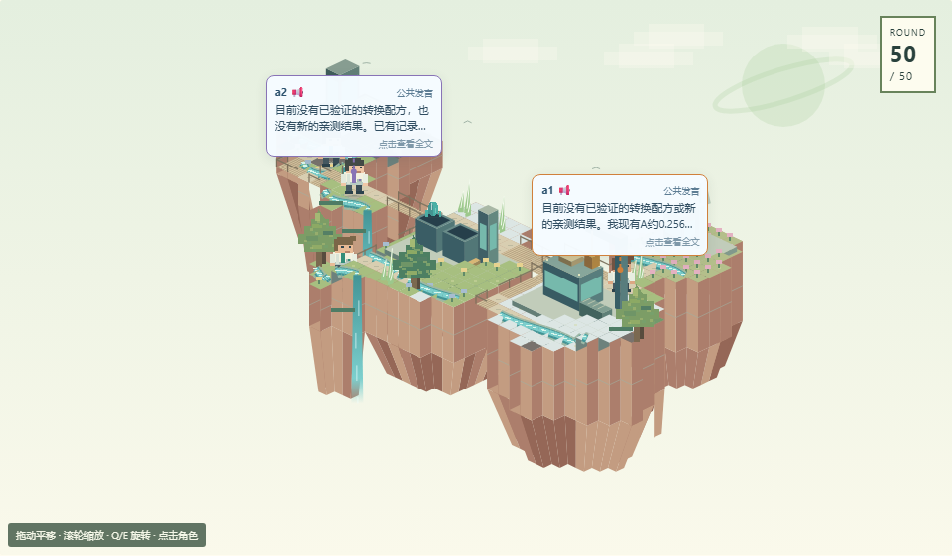

# 浮岛星球回放

每个任务的身份与种子确定一套可复原的展示地图：不规则浮岛、高低错落的地面与岛间栈桥。生态类型从十一类中选取三至五类，水色、岩层、日间天空分别从五组配色独立选取，植被从森林、晶体、蘑菇与混合型选取，再组合星环和强调色。并非固定的四套模板，也不要求每个星球出现所有景观。河流有岸线、动态水纹与瀑布，地图旋转后仍保持世界坐标一致。浅色日间界面继续作为默认。

这些生态、天气、河流与地图高度属于**展示层**，并非新增仿真法则。真实生产、生态状态、资源变化和成员行为以原始日志为准。浮岛路径也不能用于推断真实领地或空间接触。

对话预览使用屏幕像素尺寸：桌面 176 × 82，窄屏 152 × 82，不随地图相机缩放。点击可读完整原文。

成员标识条位于头顶，不随相机缩放改变字号。背景的三颗星球沿固定种子的装饰轨道运动，呈现三体式视觉效果，并不模拟真实三体引力。相连陆块共用地下网格顶点，并补全底面，防止岩层接缝出现空洞。

`check_planet_browser.py` 检查固定种子复原、出生点与设施可达、路径不穿过空白、相机旋转、对话尺寸及移动端溢出。`check_activity_browser.py` 验证地图计数、源数据不变与指标一致性。

